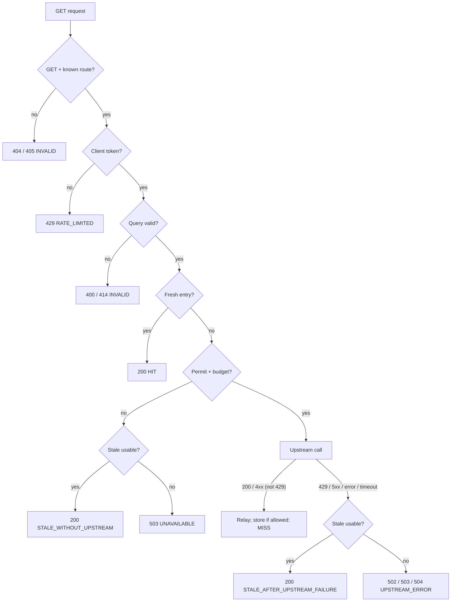

# Nimbus: A Caching, Rate-Limiting Reverse Proxy for the Open-Meteo Weather API

> **Status:** Phases 0–3 implemented. Phase 1's manual real-API check is still pending: the cloud session that built it couldn't reach Open-Meteo (egress policy). Implement later phases only when the owner explicitly says so.
> **Last updated:** 2026-10-22 (revision 2)
> **Audience:** the project owner (a high school CS student building a portfolio project with AI assistance) and any coding agent that implements this plan phase by phase.

### Revision 2 summary (what changed from revision 1)

| Area | Revision 1 | Revision 2 (this document) |
|---|---|---|
| Request normalization | Rounded coordinates; sorted variable lists; lowercased names; inserted defaults; rejected all duplicate params | **Exact values preserved.** The only changes are a stable sort by parameter *name* and canonical percent-encoding. Repeated parameters are supported. Both rules were verified against the live API (Appendix A). |
| Memory | Entry-count cap only | **Byte budget for the whole cache**, a per-entry size cap, a **hard cap on upstream response size enforced while downloading**, and a cap on concurrent upstream fetches |
| Metrics | `upstreamCallsSaved` counted stale-after-failure; loose definitions | One **outcome per request**, precise formulas, invariants checked by tests |
| Expiration | Aligned to 15-minute UTC boundaries | **Configurable TTL (forecast default 5 min)**, capped by upstream `Cache-Control`/`Expires` per RFC 9111 |
| JSON | Hand-written parser | **Gson 2.14.0** |
| Classes | Several single-use abstractions | Fewer classes (Section 4) |
| Upstream timeout | `HttpRequest.timeout` only | A **total deadline** that also covers the response body (needed on Java 21; see Section 9, problem 6) |
| Owner tracks | Six optional tracks | **Three reserved tracks:** request coalescing, custom LRU, and profile-guided optimization |

---

## Table of contents

0. [How to use this plan](#0-how-to-use-this-plan)
1. [Project overview](#1-project-overview)
2. [Features](#2-features)
3. [Architecture](#3-architecture)
4. [Project structure](#4-project-structure)
5. [Technology decisions](#5-technology-decisions)
6. [Implementation phases](#6-implementation-phases)
7. [Testing](#7-testing)
8. [Performance and benchmarking](#8-performance-and-benchmarking)
9. [Potential problems, tradeoffs, and solutions](#9-potential-problems-tradeoffs-and-solutions)
10. [Future improvements](#10-future-improvements)
11. [Interview preparation](#11-interview-preparation)
- [Appendix A: Verified external facts](#appendix-a-verified-external-facts)
- [Appendix B: Configuration reference](#appendix-b-configuration-reference)
- [Appendix C: Glossary](#appendix-c-glossary)

---

## 0. How to use this plan

**Rules for the coding agent:**

1. **Implement phases in order (Section 6).** A phase is done only when all of the following are true:
   - Its completion criteria pass.
   - `mvn -B verify` passes, with **no live-network tests**.
   - The work is committed to git with the message given in the phase.
2. **Each phase is independently testable.** It adds its own automated tests and must not depend on code from a later phase.
3. **Names are fixed by this plan:** classes, packages, endpoints, headers, metric names, and config keys. If a name has to change, update this file in the same commit.
4. **🧑‍💻 Owner tracks (Section 6, Phase 9) are off-limits for implementation.** Build only the extension point and the disabled acceptance test described there. Don't pre-optimize code paths the owner is meant to profile. Keep baselines simple and obviously correct.
5. **Never send load to the real Open-Meteo API.** Tests use in-process fakes or the local `FakeUpstreamServer`. Benchmarks are technically blocked from non-loopback targets (Section 8.2). The only real-API calls are a few manual smoke checks and the `@Tag("live")` tests, which are excluded by default.
6. When the plan and reality disagree (for example, a library behaves differently than described here), stop. Record the discrepancy in this file and choose the more conservative behavior, the one that is correct even if slower.

---

## 1. Project overview

### What we're building

**Nimbus** is a **caching, rate-limiting reverse proxy** in front of the public [Open-Meteo](https://open-meteo.com) forecast and geocoding APIs. A small **Java Swing desktop client** uses the proxy to search for cities, show current weather, and display live proxy statistics.

```
  Swing GUI ──┐
  curl        ├──HTTP──▶  Nimbus proxy (127.0.0.1:8080) ──HTTPS──▶  api.open-meteo.com
  any client ─┘           cache · rate limits · metrics             geocoding-api.open-meteo.com
```

**It's a real proxy, not a weather app with a cache:**

- It exposes **the same paths and query parameters as Open-Meteo** (`/v1/forecast`, `/v1/search`). Any Open-Meteo client can use it by changing only the base URL.
- It treats response bodies as **opaque bytes**. It never parses weather data, so every variable, unit, and output format (JSON, CSV) works unchanged.
- It follows standard **HTTP caching rules** (RFC 9111) for what it may store and for how long.
- The GUI is **just one HTTP client** of the proxy.

### Why it's useful and what problems it solves

| Problem | Without Nimbus | With Nimbus |
|---|---|---|
| **Latency** | Every request is a round trip to Open-Meteo: **~0.73–0.99 s cold** and **~0.19–0.25 s warm**, measured (Appendix A). | Cache hits are served from memory on localhost. |
| **Redundant work** | 100 identical requests make 100 upstream calls. | One upstream call, then cache hits until the TTL expires. |
| **Quota exhaustion** | Free tier: under 600/min, 5,000/hour, 10,000/day. One buggy client can exhaust the quota for everyone. | A **global upstream budget** with a safety margin, plus **per-client rate limits**. |
| **Upstream outages** | Errors reach clients. | **Stale-if-error:** the last good response is served, clearly labeled. |
| **Memory blowups** | – | **Byte-bounded cache** and **capped upstream downloads**. |
| **Observability** | None. | `/metrics` and the GUI: outcomes, hit ratio, calls saved, latency percentiles. |

### Engineering skills this demonstrates

- **Networking and HTTP:** reverse proxying, status codes, `Cache-Control`/`Age`/`Retry-After`, timeouts and deadlines, connection reuse, streaming size limits.
- **Caching:** cache-key correctness, RFC 9111 freshness, a byte-bounded LRU, stale-if-error.
- **Concurrency:** virtual threads, `ConcurrentHashMap`, locks, `LongAdder`, semaphores, and (owner track) request coalescing.
- **Reliability:** token-bucket rate limiting, upstream quota protection, cooldown after upstream 429s, graceful degradation.
- **Performance:** percentile latency, throughput, reproducible benchmarks, and (owner track) JFR profiling with a measured optimization.
- **Testing:** deterministic clocks, fakes, concurrency tests, invariant-based metric tests.

### Non-goals (v1)

- An open/forward proxy that fetches arbitrary URLs. That invites SSRF and abuse; Nimbus uses a fixed route table only.
- Conditional revalidation (`ETag`/`If-None-Match`), HTTPS termination, authentication, and multi-node deployment (Section 10).
- Graphics beyond simple, functional Swing components.

---

## 2. Features

### 2.1 Essential features (the MVP)

**Proxying**
- E1. `GET /v1/forecast` → `https://api.open-meteo.com/v1/forecast`.
- E2. `GET /v1/search` → `https://geocoding-api.open-meteo.com/v1/search`.
- E3. **Correctness-first query normalization** (Section 3.4): parameter values and the order of repeated parameters are preserved exactly. Normalization only reorders *different* parameter names and canonicalizes percent-encoding. The cache key is exactly the query sent upstream.
- E4. Upstream status codes, bodies, `Content-Type`, and `Cache-Control` are relayed. Bodies are opaque bytes.
- E5. Only `GET` is allowed (`405` with `Allow: GET` otherwise). Unknown paths get `404`. Missing required parameters (`latitude`/`longitude` for forecast, `name` for search) get `400`. Over-long queries get `414`.
- E6. Proxy-generated errors use **Open-Meteo's error JSON shape** plus a source field: `{"error":true,"reason":"...","source":"proxy"}`.

**Caching**
- E7. An in-memory **LRU cache bounded by both total bytes and entry count**.
- E8. Configurable TTL per route: **forecast 300 s (5 min)** and **geocoding 86,400 s (24 h)**.
- E9. **Upstream `Cache-Control` is respected** (Section 3.5):
  - `no-store`, `private`, or `no-cache` means don't store.
  - `s-maxage`/`max-age` (or `Expires`) can only *shorten* the configured TTL.
  - The upstream `Age` header is subtracted from the freshness lifetime.
  - `must-revalidate`, `proxy-revalidate`, or `s-maxage` (which carries `proxy-revalidate`'s semantics for shared caches, §5.2.2.10) disables stale serving for that entry.
  - `Vary: *` means don't store.
- E10. Only `200` responses no larger than `maxEntryBytes` are stored.
- E11. **Stale-if-error.** An expired entry stays usable for a stale window (forecast 1 h, geocoding 7 days). It is served, labeled `STALE`, when the upstream fails, times out, or is unavailable because of budget, cooldown, or concurrency limits.
- E12. Response headers: `X-Cache` (`HIT`, `MISS`, or `STALE`), `Age`, and `Cache-Control` (Section 3.3).

**Memory safety**
- E13. A total cache byte budget (`nimbus.cache.maxBytes`, default 64 MiB) and an entry cap (`nimbus.cache.maxEntries`).
- E14. A per-entry storage cap (`nimbus.cache.maxEntryBytes`, default 512 KiB). Bigger responses are relayed but not stored.
- E15. **A hard cap on upstream download size** (`nimbus.upstream.maxResponseBytes`, default 2 MiB), enforced *while the response streams in*. Over the cap, the download is aborted and the client gets `502`. The upstream often uses chunked encoding without `Content-Length` (Appendix A), so the cap can't rely on that header alone.
- E16. **A cap on concurrent upstream fetches** (`nimbus.upstream.maxConcurrent`, default 32). Worst-case transient download memory is therefore 32 × 2 MiB = 64 MiB.

**Rate limiting and upstream protection**
- E17. A **per-client token bucket** keyed by socket IP. Over the limit, the client gets `429` with `Retry-After`, plus `X-RateLimit-Limit` and `X-RateLimit-Remaining` on all proxied responses.
- E18. A **global upstream budget** at 80% of Open-Meteo's per-minute, per-hour, and per-day limits. Over budget, the proxy serves a stale copy or returns `503` with `Retry-After`.
- E19. **Upstream 429 cooldown:** pause upstream calls for `cooldownSeconds`, or for the upstream's `Retry-After` if that's longer.

**Resilience**
- E20. Upstream connect timeout (3 s) plus a **total deadline (5 s) that covers headers *and* body**. On timeout: stale or `504`. Connection errors and upstream 5xx: stale or `502`.

**Observability**
- E21. `GET /metrics`: JSON with request outcomes, upstream call counts, cache stats, ratios, and latency percentiles, using the precise definitions in Section 3.6.
- E22. `GET /health`: `{"status":"ok", "upstreams":[...]}`. The upstream URLs are included so the benchmark tool can verify it is talking to a fake upstream.
- E23. A one-line access log per request.

**GUI (Swing)**
- E24. City search with a pick list for ambiguous names.
- E25. Current weather: temperature, feels-like, a description from the WMO code, humidity, wind, day or night, and observation time.
- E26. How the last request was served (`HIT`, `MISS`, or `STALE`) and its client-measured latency.
- E27. A live stats panel polling `/metrics` every second.
- E28. A °C/°F toggle and a Refresh button.
- E29. Attribution: "Weather data by Open-Meteo.com (CC BY 4.0)".

**Tooling**
- E30. `FakeUpstreamServer`: an imitation of Open-Meteo with configurable latency, errors, hangs, slow bodies, body size, and `Cache-Control`.
- E31. `LoadGenerator`: uniform, Zipf, and hot-key workloads. **It refuses non-loopback targets and non-loopback upstreams.**
- E32. A single runnable JAR with modes `server | gui | all | bench | fake-upstream`.

### 2.2 Reserved for the owner (after the MVP works)

| Track | Feature | Seam the agent provides |
|---|---|---|
| 🧑‍💻 **1** | **Request coalescing:** concurrent identical misses share one upstream call. | `ProxyService.fetchFromUpstream(...)` single entry point, `Outcome.COALESCED`, `coalesced` metric, and the disabled `RequestCoalescingTest`. |
| 🧑‍💻 **2** | **Custom LRU cache:** `HashMap` + hand-written doubly linked list, replacing the `LinkedHashMap` baseline. | The `Cache` interface, a `LinkedListLruCache` stub, `CacheContractTest`, a disabled `LinkedListLruCacheTest`, and the `nimbus.cache.impl` switch. |
| 🧑‍💻 **3** | **Profile-guided optimization:** profile, find a real bottleneck, fix it, and benchmark before and after. | Benchmark harness, a JFR recipe, and a case-study template in `BENCHMARKS.md`. |

Phase 9 has the details. Other optional ideas are in Section 10 and are **not** part of the initial implementation.

---

## 3. Architecture

### 3.1 Component diagram

```
┌──────────────────────────────── Nimbus JVM (mode "all") ─────────────────────────────────┐
│  ┌──────────── GUI (Swing; EDT + SwingWorker) ────────────┐                              │
│  │ SearchPanel   WeatherPanel   StatsPanel                │                              │
│  │        └──▶ NimbusClient (HttpClient + Gson)           │                              │
│  └────────────────────┬───────────────────────────────────┘                              │
│                       │ HTTP: /v1/search, /v1/forecast, /metrics                          │
│                       ▼                                                                   │
│  ┌───────────────────────────── Proxy server ───────────────────────────────────────┐    │
│  │ com.sun.net.httpserver.HttpServer ──▶ virtual thread per request                 │    │
│  │   ProxyHandler (HttpExchange ⇄ ProxyRequest/ProxyResponse; records latency)      │    │
│  │        ▼                                                                         │    │
│  │   ProxyService  (all decisions; plain Java; unit-testable)                       │    │
│  │     ├── ClientRateLimiter ── TokenBucket per client IP                           │    │
│  │     ├── QueryNormalizer ── canonical query == cache key == upstream query        │    │
│  │     ├── Cache<String, CacheEntry> (LinkedHashMapCache: bytes + entries bounded)  │    │
│  │     ├── FreshnessPolicy + CacheControl (TTL, RFC 9111 rules)                     │    │
│  │     ├── UpstreamBudget ── minute/hour/day TokenBuckets + 429 cooldown            │    │
│  │     ├── Semaphore ── max concurrent upstream fetches                             │    │
│  │     ├── UpstreamClient ── HttpUpstreamClient (deadline + size limit) ────────────┼────┼──▶ Open-Meteo
│  │     └── ProxyMetrics ── outcome counters (LongAdder) + LatencyRecorders          │    │      (or FakeUpstreamServer)
│  │   MetricsHandler (/metrics)   HealthHandler (/health)                            │    │
│  └──────────────────────────────────────────────────────────────────────────────────┘    │
└──────────────────────────────────────────────────────────────────────────────────────────┘
```

**Key design rule:** `ProxyHandler` is a thin adapter. Every decision lives in `ProxyService`, which takes a `ProxyRequest` record and returns a `ProxyResponse` record and never touches sockets. Its dependencies (`Cache`, `UpstreamClient`, `InstantSource` clock) are injected through its constructor. Most behavior can therefore be tested with plain method calls, a `MutableClock`, and a `FakeUpstreamClient`.

### 3.2 Request flow

Each proxied request ends with **exactly one `Outcome`** (Section 3.6), shown in brackets.

```
 0. ProxyHandler: start latency timer.
 1. Method != GET ─────────────────────────────────────────────────▶ 405  [INVALID]
 2. Path not a known Route ────────────────────────────────────────▶ 404  [INVALID]
 3. ClientRateLimiter.tryAcquire(clientIp) denied ─────────────────▶ 429 + Retry-After  [RATE_LIMITED]
 4. QueryNormalizer.canonicalize(rawQuery, route)
      ├─ query too long ───────────────────────────────────────────▶ 414  [INVALID]
      ├─ malformed encoding / too many params / missing required ──▶ 400  [INVALID]
      └─ key = "/v1/forecast?current=temperature_2m&current=wind_speed_10m&latitude=52.52437&longitude=13.41053"
 5. entry = cache.get(key)
      ├─ entry past staleUntil → cache.remove(key); entry = null
      └─ entry fresh ──────────────────────────────────────────────▶ 200 X-Cache: HIT  [HIT]
 6. fetchFromUpstream(route, key)      ← Track 1 seam (coalescing goes here)
    6a. upstreamPermits.tryAcquire(permitWait) failed ──┐
    6b. UpstreamBudget.tryAcquire() denied (or cooldown)┴─▶ stale usable? 200 X-Cache: STALE  [STALE_WITHOUT_UPSTREAM]
                                                           else 503 + Retry-After            [UNAVAILABLE]
    6c. UpstreamClient.fetch(upstreamUrl + "?" + canonicalQuery)   ← counts as one upstream call
          ├─ 200 ─▶ FreshnessPolicy.decide(...)
          │          ├─ storable → cache.put(key, entry)
          │          └─ not storable (no-store, too big, …) → cache.remove(key)
          │          ─────────────────────────────────────────────▶ 200 X-Cache: MISS  [MISS]
          ├─ other non-429 status < 500 (e.g. 400, 404) ─▶ relay, don't cache ▶ X-Cache: MISS  [MISS]
          ├─ 429 ─▶ UpstreamBudget.startCooldown(...) ─┐
          ├─ ≥ 500, connection error, too large ───────┼▶ stale usable? 200 STALE  [STALE_AFTER_UPSTREAM_FAILURE]
          └─ deadline exceeded ────────────────────────┘   else 503 / 502 / 504    [UPSTREAM_ERROR]
    6d. release permit (finally)
 7. ProxyService records the Outcome count; ProxyHandler writes the response, then records latency.
 8. Any unexpected exception ──────────────────────────────────────▶ 500  [INTERNAL_ERROR]
```

"Stale usable" means `entry != null && entry.staleAllowed() && now < entry.staleUntil()`.

Error status codes when no stale copy is usable: upstream 429 → `503`; upstream 5xx, a connection failure, or a response that is too large → `502`; deadline exceeded → `504`.



### 3.3 Proxy HTTP API (the contract)

| Method & path | Upstream URL | Required params | Default TTL | Stale window |
|---|---|---|---|---|
| `GET /v1/forecast` | `https://api.open-meteo.com/v1/forecast` | `latitude`, `longitude` | 300 s | 3,600 s |
| `GET /v1/search` | `https://geocoding-api.open-meteo.com/v1/search` | `name` | 86,400 s | 604,800 s |
| `GET /metrics` | – | – | – | – |
| `GET /health` | – | – | – | – |

`/metrics` and `/health` are **not** counted in proxy metrics or rate-limited.

**Headers the proxy sets:**

| Header | When | Value |
|---|---|---|
| `X-Cache` | `HIT`, `MISS`, `STALE` (both stale outcomes), and `COALESCED` after Track 1 | Same as the outcome group. Error and rejection responses have no `X-Cache` header. |
| `Age` | `HIT`, `STALE` | Whole seconds since the entry was received, plus the upstream `Age` header if one was sent. |
| `Cache-Control` | `HIT` → `max-age=<whole seconds until freshUntil>`. `STALE` → `max-age=0`. `MISS` → the upstream `Cache-Control` relayed unchanged (absent if the upstream sent none). | |
| `Content-Type` | Proxied responses | Relayed from the upstream response or cache entry. |
| `X-RateLimit-Limit` / `X-RateLimit-Remaining` | Every response that passed step 3, and 429s | Client bucket capacity / whole tokens left. |
| `Retry-After` | `429` and `503` | Whole seconds, rounded up, at least 1. |
| `X-Upstream-Latency-Ms` | `MISS` | Duration of the upstream call. |

**Status codes the proxy generates:** `400` (malformed query, too many parameters, or missing required parameter), `404`, `405`, `414` (query longer than `nimbus.request.maxQueryLength`), `429`, `502`, `503`, `504`, and `500` (a bug: caught, logged, and never a silently dropped connection). Upstream non-429 statuses below 500 are relayed as-is.

### 3.4 Query normalization (correctness-critical)

**Invariant 1:** the cache key is `routePath + "?" + canonicalQuery`, and the upstream request is exactly `upstreamUrl + "?" + canonicalQuery`. Requests with the same key therefore send the *identical* upstream request.

**Invariant 2:** the proxy sends a **fixed set of request headers** upstream (`User-Agent`, `Accept`). It never forwards client headers and never sends `Accept-Encoding`. The upstream response therefore depends only on the URL. That is what makes a URL-based key complete, and why a `Vary` header other than `*` doesn't matter.

**Algorithm** (`QueryNormalizer.canonicalize(String rawQuery, Route route)`). Use `HttpExchange.getRequestURI().getRawQuery()`, the *raw* form, never the pre-decoded `getQuery()`.

1. `null` or empty → empty parameter list.
2. If `rawQuery.length() > maxQueryLength` (default 4,096), the request is rejected with **414**.
3. Split on `&`. Skip empty segments (`a=1&&b=2`), which carry no parameter.
4. Split each segment at the **first** `=`.
   - The name is the part before it, and the value is everything after, which may be empty.
   - A segment with no `=` has a *null* value (the `flag` form), kept distinct from `flag=` (an empty value).
   - Form-decode both parts (`+` is a space, `%XX` is a byte) **strictly**: malformed escapes like `%zz` and escaped bytes that aren't valid UTF-8 (like `%FF`) become **400**.
   - *Correction (Phase 1):* the plan originally said `URLDecoder.decode(s, UTF_8)`. On JDK 21 that silently replaces invalid UTF-8 with U+FFFD, so `%FF` and `%FE` would share one cache key and the upstream would receive a different query than the client sent. Its Javadoc leaves error handling to the implementation. `QueryNormalizer.decode` decodes with a reporting `CharsetDecoder` instead.
5. More than `maxQueryParams` parameters (default 100) → **400**.
6. **Stable-sort** the `(name, value)` pairs by name with `List.sort(Comparator.comparing(QueryParam::name))`. `List.sort` is guaranteed stable, so repeated parameters keep their original relative order.
7. Every required parameter of the route must appear at least once with a non-null value; otherwise **400**. Values themselves are **not** validated, and the upstream's own `400` is relayed (not cached).
8. Re-encode each name and value with `URLEncoder.encode(s, UTF_8)` and join them as `name=value` (or just `name` for a null value) with `&`.

**Why each step is safe** (verified against the live API on 2026-10-22; Appendix A):

| Transformation | Safe because |
|---|---|
| Reordering *different* parameter names | Query parameters are parsed into a name → values map, so the position of one name relative to another carries no meaning. Verified: `latitude,longitude,current,timezone` in two different orders gave byte-identical bodies (ignoring `generationtime_ms`). |
| Keeping the order of *same-name* parameters | Order within a name **does** matter. Repeated `latitude`/`longitude` define multiple locations, paired by position. Repeated `current` values are concatenated in order. Variable order controls JSON field order and **CSV column order**. The stable sort keeps all of these. |
| Canonical percent-encoding | `,` and `%2C` decode to the same character. Verified: identical responses. `+` decodes to a space and re-encodes back to `+`, while `%2B` stays `%2B`, so the meaning is unchanged under form decoding. |

**Deliberately *not* normalized** (correctness over hit rate):

- Number formats (`52.52` vs `52.520`).
- Letter case (`Berlin` vs `berlin`).
- Implicit defaults (`count=10`).
- Comma lists vs repeated parameters (`current=a,b` vs `current=a&current=b`).
- Empty values (`timezone=`).

Several of these happened to return identical bodies when tested, but equivalence isn't documented or guaranteed. Merging them could someday serve one request another request's output.

**Effect on hit rate:** low in practice. Clients that pick the same city send the same coordinates, because the GUI takes them verbatim from the geocoding result, such as `52.52437,13.41053`. Benchmarks use fixed coordinate lists for the same reason.

### 3.5 Freshness, storage, and staleness (RFC 9111-aligned)

```java
// Specification only. Not final code.
record CacheEntry(byte[] body, String contentType, String upstreamCacheControl,
                  Instant receivedAt, long upstreamAgeSeconds,
                  Instant freshUntil, Instant staleUntil, boolean staleAllowed) {
    boolean isFresh(Instant now)         { return now.isBefore(freshUntil); }
    boolean isStaleUsable(Instant now)   { return staleAllowed && now.isBefore(staleUntil); }
    long ageSeconds(Instant now)         { /* upstreamAgeSeconds + whole seconds since receivedAt */ }
    long weightBytes(String key)         { return body.length + 2L * key.length() + ENTRY_OVERHEAD_BYTES; }
}
```

`CacheControl.parse(List<String> headerValues)` returns a record:

```
CacheControl(noStore, noCache, isPrivate, mustRevalidate, proxyRevalidate,
             OptionalLong maxAge, OptionalLong sMaxAge)
```

Parsing rules:
- Directive names are case-insensitive. Multiple header lines and comma-separated lists are merged.
- Quoted values are unquoted.
- Qualified forms (`no-cache="Set-Cookie"`, `private="x"`) are treated **as if unqualified**. That is stricter, and still correct.
- A malformed or negative `max-age`/`s-maxage` is treated as `0`. A value too large to represent is `2^31` (§1.2.2). For a repeated directive, the first occurrence wins (§4.2.1).

**`FreshnessPolicy.decide(route, upstreamResponse, now)`** returns either `DoNotStore(reason)` or `Store(CacheEntry)`:

1. Status must be **200**. RFC 9111 §4.2.2 allows *heuristic* freshness for responses that have no explicit expiration, and 200 is heuristically cacheable. That is what the configured TTL is.
2. Don't store if `noStore` (§5.2.2.5), `isPrivate` (§5.2.2.7: shared caches must not store), or `noCache` (§5.2.2.4: requires revalidation, which Nimbus doesn't implement).
3. Don't store if any `Vary` value is `*` (§4.1: it never matches).
4. Don't store if `body.length > maxEntryBytes`.
5. **Freshness lifetime** = the route's configured TTL, possibly shortened by an upstream limit:
   - `upstreamLimit` comes from `s-maxage` if present (it takes precedence for shared caches, §4.2.1), else `max-age`, else `Expires − Date` (§5.3: an invalid `Expires` such as `"0"` means "in the past", i.e. 0; if `Date` is missing, use the receive time). If none is present, there is no upstream limit.
   - `lifetime = upstreamLimit present ? min(configuredTtl, upstreamLimit) : configuredTtl`.
   - **The upstream can only shorten the TTL, never lengthen it.**
6. `age` = the upstream `Age` header in seconds (0 if absent or invalid). `remaining = lifetime − age`. If `remaining ≤ 0`, don't store. This is the simplified §4.2.3 current-age calculation, ignoring network delay.
7. Set the timestamps:
   - `freshUntil = receivedAt + remaining`.
   - `staleAllowed = !(mustRevalidate || proxyRevalidate || sMaxAge present) && route.staleWindow > 0` (§5.2.2.2 and §5.2.2.8 forbid serving stale; §5.2.2.10 says `s-maxage` incorporates `proxy-revalidate` for a shared cache).
   - *Correction (Phase 2):* the `s-maxage` term was missing from the original plan. Open-Meteo doesn't send `s-maxage` today, so this changes nothing in practice.
   - `staleUntil = staleAllowed ? freshUntil + route.staleWindow : freshUntil`.

**Store-or-remove rule:** after any upstream `200` for a key, the cache holds either that new response or *nothing*. A non-storable 200 (`no-store`, too big, and so on) removes any older entry for the key, so an older body is never served after a newer one was observed. Non-200 upstream responses leave existing entries alone, so they remain available for stale-if-error.

**About serving stale content:** RFC 9111 §4.2.4 lets a cache serve stale responses when it is disconnected from the origin, or when this is explicitly permitted, for example by operator configuration. Nimbus's stale-if-error is that operator configuration. It is off for an entry when the upstream sent `must-revalidate` or `proxy-revalidate`, and off entirely when the stale window is 0. Stale responses are always labeled with `X-Cache: STALE`, `Age`, and `Cache-Control: max-age=0`. The obsolete `Warning` header isn't used.

**What Open-Meteo actually sends** (Appendix A): the forecast endpoint has **no `Cache-Control`**, so the configured 5-minute TTL applies. Geocoding sends `public, max-age=86400`, so the lifetime is `min(86400, 86400)`. Error responses have no caching headers and are never stored anyway.

### 3.6 Metrics model (precise definitions)

**Every proxied request** — any request except `/metrics` and `/health` — increments `requests.total` exactly once and **exactly one** outcome counter:

| `Outcome` | Own upstream call? | Response | Counts as served from cache? |
|---|---|---|---|
| `HIT` | No | Fresh cached 200 | Yes |
| `COALESCED` (Track 1) | No; it shared another request's call | The leader's upstream response | No (shared) |
| `STALE_WITHOUT_UPSTREAM` | No (budget, cooldown, or no concurrency permit) | Stale cached 200 | Yes |
| `MISS` | Yes, and a response was received | Relayed upstream response (200, or a non-429 status below 500) | No |
| `STALE_AFTER_UPSTREAM_FAILURE` | Yes, and it failed (429, 5xx, timeout, connection, too large) | Stale cached 200 | Yes |
| `UPSTREAM_ERROR` | Yes, and it failed | 502, 503, or 504 | No |
| `UNAVAILABLE` | No (budget, cooldown, or no permit) | 503 | No |
| `RATE_LIMITED` | No | 429 | No |
| `INVALID` | No | 400, 404, 405, or 414 | No |
| `INTERNAL_ERROR` | Possibly | 500 | No |

**Upstream counters** are incremented at the single place where `UpstreamClient.fetch` is called:
- `upstream.calls`: HTTP requests actually sent. No retries exist, so there is at most one per proxied request.
- `upstream.responses`: a complete response was received within limits, with any status. `upstream.status429` and `upstream.status5xx` break it down.
- `upstream.failures.timeout`, `.connection`, and `.tooLarge`. An `INTERRUPTED` call (shutdown) counts as `.connection`, so I3 still holds.
- `upstream.skipped.budget`, `.cooldown`, and `.noPermit`: requests that needed the upstream but didn't call it.

**Derived values:**

| Name | Formula | Notes |
|---|---|---|
| `lookups` | `HIT + COALESCED + STALE_WITHOUT_UPSTREAM + MISS + STALE_AFTER_UPSTREAM_FAILURE + UPSTREAM_ERROR + UNAVAILABLE` | Requests that reached the cache lookup (step 5). |
| `upstreamCallsSaved` | `HIT + COALESCED + STALE_WITHOUT_UPSTREAM` | Requests answered **without making their own upstream call**. `STALE_AFTER_UPSTREAM_FAILURE` is excluded because the upstream *was* contacted. Rejections (`RATE_LIMITED`, `INVALID`, `UNAVAILABLE`) are excluded because no data was served. |
| `stale.total` | `STALE_WITHOUT_UPSTREAM + STALE_AFTER_UPSTREAM_FAILURE` | Both kinds are also reported separately. |
| `cacheHitRatio` | `HIT / lookups` | Fresh hits only. `null` when `lookups == 0`. |
| `upstreamAvoidanceRatio` | `upstreamCallsSaved / lookups` | `null` when `lookups == 0`. |

**Invariants** (asserted by tests once all requests have finished):
- **I1:** `requests.total == Σ outcomes`.
- **I2:** `upstream.calls == MISS + STALE_AFTER_UPSTREAM_FAILURE + UPSTREAM_ERROR + (INTERNAL_ERRORs that happened after the call)`. In tests without injected bugs, the last term is 0.
- **I3:** `upstream.calls == upstream.responses + Σ upstream.failures`.
- **I4:** `upstream.calls` equals the number of requests `FakeUpstreamServer` received (integration tests).
- **I5:** `cache.bytes ≤ maxBytes` and `cache.entries ≤ maxEntries` at all times.

**Latency** (recorded in nanoseconds, reported in milliseconds with 3 decimals):
- **Server latency** runs from the first line of `ProxyHandler.handle` until the response body has been written and the exchange closed. It excludes time spent in the server's accept queue and request parsing; the client-side benchmark captures that.
- Server latency is recorded for **every proxied request**, into recorders `all`, `hit`, `miss` (which includes upstream time), and `stale` (both stale outcomes).
- **Upstream latency** covers each `UpstreamClient.fetch` call, including failures, in recorder `upstream`.
- **Client latency** (GUI and `LoadGenerator`) runs from just before `HttpClient.send` until the body has been fully read.
- **Percentiles** use the nearest-rank method over a sliding window of the most recent `nimbus.metrics.latencyWindow` samples (default 4,096) per recorder. To compute one, sort the window and take `index = ceil(p/100 × n) − 1`. Each recorder reports `count` (samples in the window), `totalRecorded` (all time), `p50`, `p95`, `p99`, and `max` (the window's max). With an empty window, the values are `null`.

**Ordering:** `ProxyService` increments the outcome counter *before* returning (it also catches its own unexpected exceptions and counts them as `INTERNAL_ERROR`; `ProxyHandler`'s catch-all counts one only if the service itself throws), and `ProxyHandler` records latency *after* writing. A client that has just received a response therefore always sees that request's outcome counted, but its latency sample may arrive a moment later. Tests that check latency counts must poll with a timeout.

**Snapshot consistency:** `LongAdder.sum()` reads aren't atomic across counters. While requests are still in flight, a snapshot may be off by those requests. The invariants hold exactly once traffic stops, which is when tests check them.

`GET /metrics` response:

```json
{
  "uptimeSeconds": 3600,
  "requests": {
    "total": 1205,
    "outcomes": { "HIT": 940, "COALESCED": 0, "STALE_WITHOUT_UPSTREAM": 3, "MISS": 200,
                  "STALE_AFTER_UPSTREAM_FAILURE": 7, "UPSTREAM_ERROR": 2, "UNAVAILABLE": 0,
                  "RATE_LIMITED": 40, "INVALID": 13, "INTERNAL_ERROR": 0 }
  },
  "derived": { "lookups": 1152, "upstreamCallsSaved": 943, "staleTotal": 10,
               "cacheHitRatio": 0.816, "upstreamAvoidanceRatio": 0.819 },
  "upstream": { "calls": 209, "responses": 203, "status429": 0, "status5xx": 4,
                "failures": { "timeout": 2, "connection": 4, "tooLarge": 0 },
                "skipped": { "budget": 3, "cooldown": 0, "noPermit": 0 },
                "cooldownActive": false, "inFlight": 0 },
  "cache": { "entries": 180, "maxEntries": 10000, "bytes": 151234, "maxBytes": 67108864,
             "evictions": 0, "impl": "linkedhashmap" },
  "latencyMs": {
    "all":      { "count": 1205, "totalRecorded": 1205, "p50": 0.41, "p95": 205.1, "p99": 248.7, "max": 951.2 },
    "hit":      { "count": 940,  "totalRecorded": 940,  "p50": 0.32, "p95": 0.88,  "p99": 1.61,  "max": 4.20 },
    "miss":     { "count": 200,  "totalRecorded": 200,  "p50": 198.0,"p95": 239.4, "p99": 266.0, "max": 951.2 },
    "stale":    { "count": 10,   "totalRecorded": 10,   "p50": 0.40, "p95": 5003.1,"p99": 5003.1,"max": 5003.1 },
    "upstream": { "count": 209,  "totalRecorded": 209,  "p50": 196.5,"p95": 237.0, "p99": 5001.2,"max": 5001.9 }
  }
}
```

(The numbers are illustrative. Note how `STALE_AFTER_UPSTREAM_FAILURE` latency includes the 5 s deadline, a useful thing to see on a dashboard.)

### 3.7 Memory model and eviction rules

| Bound | Default | Enforced where | Behavior when exceeded |
|---|---|---|---|
| `nimbus.upstream.maxResponseBytes` | 2 MiB | `LimitedBodySubscriber` during download. An early check rejects a `Content-Length` over the limit. | Download aborted (subscription cancelled). `upstream.failures.tooLarge++`. Stale or `502`. |
| `nimbus.upstream.maxConcurrent` | 32 | `Semaphore` in `ProxyService` | Wait up to `permitWaitMs`, then `skipped.noPermit++` and stale or `503`. |
| `nimbus.cache.maxEntryBytes` | 512 KiB | `FreshnessPolicy` | Relayed to the client but not stored. The older entry is removed (store-or-remove rule). |
| `nimbus.cache.maxBytes` | 64 MiB | `Cache.put` | LRU eviction until under the bound. |
| `nimbus.cache.maxEntries` | 10,000 | `Cache.put` | LRU eviction until under the bound. |
| `nimbus.request.maxQueryLength` | 4,096 chars | `QueryNormalizer` | `414` |

`NimbusConfig` validates `maxEntryBytes ≤ maxResponseBytes` and `maxEntryBytes ≤ maxBytes`, and fails at startup otherwise.

**Entry weight** = `body.length + 2 × key.length() + ENTRY_OVERHEAD_BYTES`, where `ENTRY_OVERHEAD_BYTES = 256`. The overhead is an **estimate** of the object headers, `Instant`s, strings, and map and list nodes. It is documented as approximate. Benchmark B6 checks real heap usage against it.

**Eviction rules** (the `Cache` contract, identical for the baseline and the Track 2 implementation):

1. `get(k)` returns the value and marks it **most recently used**, or returns `null`. A miss changes nothing.
2. `put(k, v)` with weight `w`:
   - If `w > maxBytes`: don't store, remove any existing mapping for `k`, and return `false`.
   - Otherwise insert or replace `k` as most recently used. On replace, subtract the old weight and add the new one.
   - Then **evict least-recently-used entries while `size > maxEntries || bytes > maxBytes`**. The entry just inserted is never evicted by its own `put`, because `w ≤ maxBytes` and `maxEntries ≥ 1`.
   - Return `true`.
3. `remove(k)` and `clear()` adjust `bytes` and `size`. Only capacity-driven removals count as **evictions**, not `remove`, `clear`, or replacement.
4. The cache knows nothing about time. Expired entries count toward the bounds until LRU evicts them, or until `ProxyService` removes them lazily on lookup once they are past `staleUntil`.
5. All operations run in O(1) time, amortized over evictions.

**Response bodies aren't copied.** The `byte[]` received from the upstream is stored and written to clients directly. That avoids doubling memory per miss. Code must treat it as **immutable**; this is documented on `CacheEntry` and checked by a test comparing served bytes to upstream bytes.

### 3.8 Threading model

- **Server:** `HttpServer` with `setExecutor(Executors.newVirtualThreadPerTaskExecutor())`, giving one virtual thread per request with simple blocking code. **Gotcha:** without `setExecutor`, handlers run on the single dispatcher thread, one request at a time.
- **Upstream client:** one shared `HttpClient`. It is thread-safe, pools keep-alive connections, and is `AutoCloseable` since Java 21. Reusing connections matters: about 0.85 s cold vs. about 0.19 s warm (Appendix A).
- **Deadline:** call `sendAsync(...)` and wait with `future.get(deadline)`. On `TimeoutException`, call `future.cancel(true)`, which the JDK documents as an attempt to cancel the HTTP exchange. This is required because `HttpRequest.timeout` in Java 21 covers only the time until response **headers** arrive (JDK-8208693).
- **Locks:**
  - Use `ReentrantLock`, not `synchronized`. On Java 21, blocking inside `synchronized` pins the virtual thread to its carrier (fixed in JDK 24 by JEP 491).
  - **Never hold a lock during I/O.**
  - Locks exist only inside `LinkedHashMapCache`, `TokenBucket`, and `UpstreamBudget`, and each guards a few memory operations.
- **GUI:** Swing components are touched only on the Event Dispatch Thread. Network calls run in `SwingWorker`s. A `javax.swing.Timer` drives metrics polling and skips a tick if the previous poll is still running.

---

## 4. Project structure

Base package: **`dev.nimbus`**. Rename it in Phase 0 if you prefer `io.github.<username>.nimbus`. The project doesn't use JPMS (no `module-info.java`). `com.sun.net.httpserver` is a supported, exported JDK API in the `jdk.httpserver` module.

```
nimbus/
├── PLAN.md
├── README.md                         ← Phase 8
├── BENCHMARKS.md                     ← Phase 7 (baseline) and Phase 9 (owner case studies)
├── pom.xml
├── .gitignore                        ← target/, .idea/, *.iml, bench-results/, *.jfr, .DS_Store
├── config/
│   └── bench.properties              ← Phase 7: loopback upstreams + high limits for benchmarking
├── .github/workflows/ci.yml          ← Phase 8 (optional)
├── src/main/resources/
│   └── nimbus.properties             ← defaults (Appendix B)
├── src/main/java/dev/nimbus/
│   ├── Main.java
│   ├── config/   NimbusConfig.java
│   ├── server/   ProxyServer.java  ProxyHandler.java  MetricsHandler.java  HealthHandler.java  HttpUtil.java
│   ├── proxy/    ProxyService.java  ProxyRequest.java  ProxyResponse.java  Outcome.java  Route.java
│   │             QueryNormalizer.java  BadRequestException.java
│   ├── cache/    Cache.java  LinkedHashMapCache.java  LinkedListLruCache.java (Track 2 stub)
│   │             CacheEntry.java  CacheControl.java  FreshnessPolicy.java
│   ├── ratelimit/ TokenBucket.java  ClientRateLimiter.java  RateLimitDecision.java  UpstreamBudget.java
│   ├── upstream/ UpstreamClient.java  HttpUpstreamClient.java  LimitedBodySubscriber.java
│   │             UpstreamResponse.java  UpstreamException.java
│   ├── metrics/  ProxyMetrics.java  LatencyRecorder.java  MetricsSnapshot.java
│   ├── client/   NimbusClient.java  ClientResult.java  Location.java  CurrentWeather.java  WeatherCodes.java
│   ├── gui/      NimbusApp.java  SearchPanel.java  WeatherPanel.java  StatsPanel.java  Formatters.java
│   └── bench/    FakeUpstreamServer.java  LoadGenerator.java  Workload.java
└── src/test/java/dev/nimbus/
    ├── testutil/ MutableClock.java  FakeUpstreamClient.java  ReferenceLruModel.java  TestEntries.java
    └── …mirrors main packages (Section 7)
```

**Removed in revision 2:**
- `Json`/`JsonException` → replaced by Gson.
- `RequestNormalizer`, `ForecastNormalizer`, `GeocodingNormalizer`, `NormalizedRequest` → one `QueryNormalizer`, because both routes use the same algorithm and only the required parameters differ, which live in `Route`.
- `TtlPolicy`, `ForecastTtlPolicy`, `FixedTtlPolicy` → one `FreshnessPolicy`.
- `CacheStatus` → `Outcome`.
- `BenchReport` → folded into `LoadGenerator`.

### Class responsibilities

| Class | Responsibility |
|---|---|
| `Main` | `static int run(String[] args)` returns an exit code, and `main` calls `System.exit(run(args))`. Parses the mode (`server`, `gui`, `all` (default), `bench`, or `fake-upstream`) and the `--key=value` flags, builds `NimbusConfig`, and wires objects together with plain constructors. Adds a shutdown hook that stops the server and closes the `HttpClient`. |
| `NimbusConfig` | Immutable record. Precedence, lowest to highest: classpath `nimbus.properties` < `--config=<file>` < environment (`NIMBUS_CACHE_MAXBYTES`) < system properties (`-Dnimbus.cache.maxBytes`) < CLI flags (`--nimbus.cache.maxBytes=…`). Validates ranges and relationships (Section 3.7) and fails fast with clear messages. Builds the two `Route`s. |
| `ProxyServer` | Creates and binds `HttpServer` (default `127.0.0.1:8080`; port 0 means a free port, for tests). Sets the virtual-thread executor and registers `/` (the proxy handler, so unknown paths also get a JSON 404), `/metrics`, and `/health`. Longest-prefix matching sends `/metrics` and `/health` to their own handlers. Owns the `ScheduledExecutorService` for idle-bucket eviction. `start()`, `stop()`, `port()`. |
| `ProxyHandler` | Converts `HttpExchange` → `ProxyRequest` (method, path, raw query, client IP). Calls `ProxyService`, writes the `ProxyResponse`, and records latency. A catch-all turns any exception into a JSON 500 with `INTERNAL_ERROR`. Always closes the exchange in `finally`. A client disconnect during the write is logged at DEBUG level. |
| `MetricsHandler` | `GET /metrics` → `ProxyMetrics.snapshot()` serialized with Gson. |
| `HealthHandler` | `GET /health` → `{"status":"ok","upstreams":["<forecast url>","<geocoding url>"]}`. |
| `HttpUtil` | `sendBytes`, `sendJson`, `sendError`. **Always pass the exact body length to `sendResponseHeaders`, or `-1` for no body. `0` means chunked.** |
| `ProxyService` | Implements Section 3.2. Constructor: `(List<Route>, Cache<String,CacheEntry>, UpstreamClient, ClientRateLimiter, UpstreamBudget, Semaphore, FreshnessPolicy, ProxyMetrics, InstantSource, NimbusConfig)`. Every miss goes through `private ProxyResponse fetchFromUpstream(Route, String key, CacheEntry staleCandidate)`, the Track 1 seam. |
| `ProxyRequest` / `ProxyResponse` | Records: `(method, path, rawQuery, clientId)` and `(status, Map<String,String> headers, byte[] body, Outcome outcome)`. |
| `Outcome` | Enum (Section 3.6) with `xCacheHeader()`, which returns `"HIT"`, `"MISS"`, `"STALE"`, `"COALESCED"`, or `null`. |
| `Route` | `record Route(String path, URI upstreamUrl, Set<String> requiredParams, Duration ttl, Duration staleWindow)`. |
| `QueryNormalizer` | Section 3.4. `String canonicalize(String rawQuery, Route route) throws BadRequestException`. `BadRequestException` carries the status (400 or 414) and reason. Nested `record QueryParam(String name, String value)`. |
| `Cache<K,V>` | Interface: `V get(K)`, `boolean put(K,V)`, `V remove(K)`, `void clear()`, `int size()`, `long weightedSize()`, `long evictionCount()`, and `List<K> keysInLruOrder()` (a snapshot from least to most recently used that doesn't change recency; O(n), for the model test and C1's key iteration — added in Phase 2). Implementations take `(int maxEntries, long maxBytes, ToLongBiFunction<K,V> weigher)` in their constructor. |
| `LinkedHashMapCache<K,V>` | **Baseline.** `new LinkedHashMap<>(16, 0.75f, true)` (access order) guarded by one `ReentrantLock`. Eviction loops over `map.entrySet().iterator()` from the eldest entry while over a bound. It doesn't use `removeEldestEntry`, which removes at most one entry per `put` and can't enforce a byte bound. |
| `LinkedListLruCache<K,V>` | **Track 2 stub only:** a constructor and methods that throw `UnsupportedOperationException("Track 2: owner implements")`, plus Javadoc listing the invariants to maintain. |
| `CacheEntry` | Section 3.5. |
| `CacheControl` | Parsing record (Section 3.5). |
| `FreshnessPolicy` | `Decision decide(Route, UpstreamResponse, Instant now)`, where `Decision` is a sealed interface with `Store(CacheEntry)` and `DoNotStore(String reason)`. |
| `TokenBucket` | `capacity`, `refillPerSecond`, `double tokens`, `Instant lastRefill`, and a lock. `tryAcquire()` refills lazily (negative elapsed time clamps to 0), then takes a token. Also `availableTokens()` and `secondsUntilNextToken()`. |
| `ClientRateLimiter` | `ConcurrentHashMap<String, TokenBucket>` using `computeIfAbsent`. `tryAcquire(clientId)` returns a `RateLimitDecision(allowed, limit, remaining, retryAfterSeconds)`. `evictIdle(Duration)` is scheduled every 60 s. |
| `UpstreamBudget` | Minute, hour, and day `TokenBucket`s. `tryAcquire()` takes from **all or none** (check all, then take all, under one lock). `startCooldown(Duration)`; `cooldownActive()`; `skipReason()` for metrics. |
| `UpstreamClient` | Interface: `UpstreamResponse fetch(URI) throws UpstreamException`. |
| `HttpUpstreamClient` | Shared `HttpClient` with a connect timeout. Per request it sends `User-Agent: nimbus-proxy/<version>` and `Accept: */*` and calls `sendAsync` with `LimitedBodySubscriber`. It enforces the deadline (Section 3.8) and maps failures: `TimeoutException`/`HttpTimeoutException` → `TIMEOUT`, `ResponseTooLargeException` → `TOO_LARGE`, other `IOException` → `CONNECTION`, and `InterruptedException` → restore the interrupt flag and throw `INTERRUPTED`. |
| `LimitedBodySubscriber` | `HttpResponse.BodySubscriber<byte[]>`. In `onSubscribe` it calls `request(Long.MAX_VALUE)`. In `onNext` it accumulates bytes, and if the total exceeds the limit it calls `subscription.cancel()` and completes exceptionally with `ResponseTooLargeException`. `onError` completes exceptionally and `onComplete` completes with the bytes. The `BodyHandler` lambda checks `Content-Length` first and rejects early if it is over the limit. On JDK 25+, `BodyHandlers.limiting` does the same job (Section 10). |
| `UpstreamResponse` | Record: `(int status, byte[] body, java.net.http.HttpHeaders headers, long latencyNanos)`, with helpers `contentType()` and `firstHeader(name)`. |
| `UpstreamException` | Unchecked exception with `Kind` = `TIMEOUT`, `CONNECTION`, `TOO_LARGE`, or `INTERRUPTED`. |
| `ProxyMetrics` | `EnumMap<Outcome, LongAdder>` plus the upstream counters (`LongAdder`), an `AtomicInteger inFlight`, and five `LatencyRecorder`s. `snapshot()` returns a `MetricsSnapshot`. |
| `LatencyRecorder` | Ring buffer: an `AtomicLongArray` of size N plus an `AtomicLong` write index. `record(nanos)`. `snapshot()` copies the filled part, sorts it, and computes nearest-rank percentiles. |
| `MetricsSnapshot` | Nested records matching the JSON in Section 3.6. Gson serializes them on the server and deserializes them in the GUI. |
| `NimbusClient` | GUI-side `HttpClient` + Gson. `search(name)`, `currentWeather(Location, Units)`, and `metrics()`, each returning a `ClientResult<T>(T value, String xCache, long latencyMillis, int httpStatus, String error)`. |
| `Location`, `CurrentWeather` | Records with `@SerializedName` on components whose JSON names are snake_case, such as `temperature_2m`. **Use boxed types (`Double`, `String`) for optional fields**, since Gson leaves missing fields `null`. The geocoding response has no `results` key when nothing matches; treat that as an empty list. |
| `WeatherCodes` | WMO code → description (Appendix A). Unknown codes map to `"Unknown (code N)"`. |
| `NimbusApp`, `SearchPanel`, `WeatherPanel`, `StatsPanel` | Section 6, Phase 6. |
| `Formatters` | Pure, unit-tested functions: temperature with units, degrees → 8-point compass, percentages, durations, and `null` → "–". |
| `FakeUpstreamServer` | Loopback-only `HttpServer` imitating both routes. Modes: `normal`, `error500`, `status429`, `hang` (never responds), and `trickle` (sends headers, then the body very slowly). Options: `latencyMs`, `jitterMs`, `errorRate`, `bodyBytes` (pads the response), `cacheControl` (header to send), and `chunked` (omit `Content-Length`). Counts requests in total and per query. Exposes `GET /__stats` and a Java API. |
| `Workload` | Deterministic key generator from a seeded `Random`: `uniform(n)`, `zipf(n, s)` (precomputed CDF plus binary search), and `hot()`. Keys are drawn from a fixed list of `n` exact coordinate pairs, generated once with a seed and 5 decimal places, the way geocoding returns them. |
| `LoadGenerator` | Section 8. Closed-loop virtual-thread clients. Per-thread `long[]` latency buffers are merged at the end. Prints a Markdown table and writes JSON. **Loopback guards** (Section 8.2). |

**Test utilities:**
- `MutableClock`: an `InstantSource` with `advance(Duration)`.
- `FakeUpstreamClient`: scripted responses and exceptions, a call counter, and an optional latch to block calls.
- `ReferenceLruModel`: a deliberately simple O(n) `ArrayList`-based LRU with the same byte and entry rules, used to check implementations against with random operations.
- `TestEntries`: builders for `CacheEntry` and `UpstreamResponse`.

---

## 5. Technology decisions

| Concern | Choice | Why | Rejected |
|---|---|---|---|
| Language | **Java 21 LTS**, `<maven.compiler.release>21</maven.compiler.release>` | Records, sealed interfaces, switch patterns, virtual threads, and `HttpClient`. The dev machine has JDK 25.0.2; `--release 21` keeps the code 21-compatible. | – |
| Build | **Maven 3.9.x** (3.9.14 installed) | Standard. | Gradle |
| HTTP server | **`com.sun.net.httpserver.HttpServer`** (JDK) | No dependency, enough for this proxy, and works with virtual threads. | Netty, Jetty, Javalin, Spring: they hide the interesting parts. |
| HTTP client | **`java.net.http.HttpClient`** (JDK) | Connection pooling, async API, cancellable futures. | OkHttp, Apache HttpClient |
| JSON | **Gson 2.14.0** (`com.google.code.gson:gson`) | One small JAR with no transitive dependencies. Supports records since 2.10. Used only by the GUI client, `/metrics`, and proxy error bodies. **The proxy never parses upstream bodies.** | Jackson (heavier), hand-written parser (an unrelated exercise) |
| GUI | **Swing** (JDK) | Ships with the JDK; the whole project stays in Java. | JavaFX: unbundled since JDK 11, needs OpenJFX dependencies and a plugin, with no benefit here. |
| Testing | **JUnit Jupiter 6.1.3** via `junit-bom` (JUnit 6 requires Java 17+) | `@Timeout`, `@RepeatedTest`, `@ParameterizedTest`, `@Tag`, abstract contract tests. | Mockito: hand-written fakes are clearer. |
| Test runner | **maven-surefire-plugin 3.6.0** | Excludes `@Tag("live")` by default. Includes `*IT` classes as well as `*Test`, so `mvn -B verify` runs the loopback socket tests too. | – |
| Compiler plugin | **maven-compiler-plugin 3.16.0** | Latest stable 3.x. Avoid the 4.0.0 betas. | – |
| Packaging | **maven-shade-plugin 3.6.2**, producing one runnable JAR `target/nimbus.jar` with Gson included and `Main-Class: dev.nimbus.Main` | `java -jar` just works. | Assembly plugin, manual classpath |
| Logging | `System.Logger` (JDK, backed by `java.util.logging`) | No dependency. | SLF4J/Logback |
| Clock | `java.time.InstantSource` injected everywhere time matters | Deterministic tests. | Scattered `System.currentTimeMillis()` |
| Profiling | **JDK Flight Recorder** + `jfr view` (built into JDK 21) | No extra install. | async-profiler (optional extra for Track 3) |

**Runtime dependencies: Gson only. Test dependencies: JUnit only.**

`pom.xml` skeleton (versions checked on Maven Central on 2026-10-22 and re-checked in Phase 0 the same day: all five are still the latest stable releases):

```xml
<groupId>dev.nimbus</groupId><artifactId>nimbus</artifactId><version>0.1.0-SNAPSHOT</version>
<properties>
  <maven.compiler.release>21</maven.compiler.release>
  <project.build.sourceEncoding>UTF-8</project.build.sourceEncoding>
  <junit.version>6.1.3</junit.version>
  <gson.version>2.14.0</gson.version>
</properties>
<dependencyManagement><dependencies>
  <dependency><groupId>org.junit</groupId><artifactId>junit-bom</artifactId>
    <version>${junit.version}</version><type>pom</type><scope>import</scope></dependency>
</dependencies></dependencyManagement>
<dependencies>
  <dependency><groupId>com.google.code.gson</groupId><artifactId>gson</artifactId><version>${gson.version}</version></dependency>
  <dependency><groupId>org.junit.jupiter</groupId><artifactId>junit-jupiter</artifactId><scope>test</scope></dependency>
</dependencies>
<build>
  <plugins>
    <!-- maven-compiler-plugin 3.16.0: <compilerArgs><arg>-Xlint:all</arg></compilerArgs> -->
    <!-- maven-surefire-plugin 3.6.0: <excludedGroups>live</excludedGroups> -->
    <!-- maven-shade-plugin 3.6.2: package phase; ManifestResourceTransformer mainClass=dev.nimbus.Main;
         finalName/outputFile so the runnable jar is target/nimbus.jar -->
  </plugins>
</build>
```

---

## 6. Implementation phases

| Phase | Name | Independently testable outcome |
|---|---|---|
| 0 | Project setup | Builds; `MainTest` passes |
| 1 | Pass-through proxy (no cache) | Real HTTP proxy relays to the fake upstream; normalization and upstream limits tested |
| 2 | Caching | HIT/MISS, byte-bounded LRU, RFC 9111 freshness, all tested |
| 3 | Metrics and observability | `/metrics` with exact, invariant-checked numbers |
| 4 | Rate limiting and upstream protection | 429s, budget, cooldown, concurrency cap |
| 5 | Resilience and concurrency hardening | Stale-if-error, deadlines, concurrency suite, Track 1 and 2 seams |
| 6 | Swing GUI | Usable client and dashboard |
| 7 | Fake-upstream benchmarking | Load generator, baseline `BENCHMARKS.md` |
| 8 | Documentation and polish | README, CI, demo-ready |
| 9 | 🧑‍💻 Owner tracks | Coalescing, custom LRU, profile-guided optimization |

**Every phase ends with:**
1. All the phase's tests are written and `mvn -B verify` is green, with no live tests and no `Thread.sleep`-based timing except the documented socket-timeout tests.
2. Manual checks, if any, are done.
3. `git add -A && git commit -m "Phase N: <title>"`. The commit also includes any `PLAN.md` corrections.

---

### Phase 0: Project setup

**Tasks**
1. `git init` and add `.gitignore`. (In practice the repository already existed, so only `.gitignore` was added.)
2. Create `pom.xml` per Section 5.
3. Create the package directories. Write `Main.run(args)`: each mode prints `"<mode>: not implemented yet"` and returns 0, an unknown mode prints usage and returns 2.
4. Add `src/main/resources/nimbus.properties` with all keys from Appendix B.
5. Write `MainTest`: an unknown mode returns 2, and `--help` returns 0.

**Deliverables:** a skeleton project and a runnable JAR.

**Completion criteria**
- `mvn -B verify` is green.
- `java -jar target/nimbus.jar bogus` prints usage and exits with code 2.
- `unzip -l target/nimbus.jar | grep com/google/gson` shows that Gson is shaded in.

**Commit:** `Phase 0: project skeleton`

---

### Phase 1: Pass-through proxy (no cache yet)

**Tasks**
1. `NimbusConfig` (with all keys; later phases just start reading theirs) and `Route`.
2. `QueryNormalizer` and `BadRequestException` (Section 3.4).
3. `UpstreamClient`, `HttpUpstreamClient`, `LimitedBodySubscriber`, `UpstreamResponse`, `UpstreamException`, with the deadline and size limit (Sections 3.7 and 3.8).
4. `ProxyRequest`, `ProxyResponse`, and `Outcome` (all values defined now; this phase only produces `MISS`, `UPSTREAM_ERROR`, `INVALID`, and `INTERNAL_ERROR`).
5. `ProxyService`, forward-only: validate → canonicalize → `fetchFromUpstream` → relay. With no cache yet, failures map straight to 502/504.
6. `ProxyServer`, `ProxyHandler`, `HealthHandler`, `HttpUtil`, plus the `Main server` mode and the access log.
7. `FakeUpstreamServer` (all modes and options), `MutableClock`, `FakeUpstreamClient`.

**Tests**
- `QueryNormalizerTest`, parameterized:
  - **Equal keys:** different name order (`latitude…&longitude…` vs `longitude…&latitude…`); `%2C` vs `,`; empty segments (`a=1&&b=2`).
  - **Different keys:**
    - `current=a,b` vs `current=b,a` (order kept).
    - `current=a&current=b` vs `current=b&current=a`.
    - `latitude=1&latitude=2&longitude=3&longitude=4` vs swapped longitude values (pairing kept).
    - `52.52` vs `52.520`, and `Berlin` vs `berlin`.
    - `flag` vs `flag=`, and `+` vs `%2B`.
    - `name=Berlin` vs `name=Berlin&count=10`.
  - **Errors:** missing required parameter → 400; `%zz` → 400; 101 params → 400; a 4,097-character query → 414.
  - **Unicode:** `Zürich` and `São Paulo` round-trip.
  - The stable sort keeps the relative order of all same-name values (a property test over random lists).
- `HttpUpstreamClientTest` against `FakeUpstreamServer`:
  - 200, 400, 429, and 500 are returned as responses (not exceptions).
  - `hang` → `TIMEOUT` within deadline + 1 s.
  - **`trickle` → `TIMEOUT` within deadline + 1 s.** This proves the deadline covers the body.
  - A chunked 10 MiB body with a 1 MiB limit → `TOO_LARGE`, quickly.
  - A `Content-Length` over the limit → `TOO_LARGE` before the body is read.
  - Connection refused (closed port) → `CONNECTION`.
  - Headers are exposed.
- `ProxyServiceTest` (forward-only part, using `FakeUpstreamClient`):
  - The upstream receives the canonical URL.
  - Status, body, `Content-Type`, and `Cache-Control` are relayed.
  - 404, 405, and 400 make no upstream call.
  - Timeout → 504 and too large → 502, each with JSON error bodies.
- `ProxyServerIT` (real sockets, port 0, `FakeUpstreamServer`):
  - End-to-end relay works, and `/health` lists the upstream URLs.
  - A handler exception → 500 JSON, and the next request still works.

**Completion criteria**
- All tests above are green.
- One manual check against the real API (two requests total):
  ```
  java -jar target/nimbus.jar server
  curl -i "http://127.0.0.1:8080/v1/search?name=Berlin&count=3"
  curl -i "http://127.0.0.1:8080/v1/forecast?latitude=52.52437&longitude=13.41053&current=temperature_2m"
  ```

**Commit:** `Phase 1: pass-through proxy with canonical queries and bounded upstream client`

---

### Phase 2: Caching

**Tasks**
1. The `Cache` interface and `LinkedHashMapCache` (Section 3.7 rules).
2. `CacheEntry`, `CacheControl`, and `FreshnessPolicy` (Section 3.5).
3. `ProxyService`:
   - Lookup at step 5: fresh → `HIT`; past `staleUntil` → remove.
   - Store-or-remove after an upstream 200.
   - `Age`, `Cache-Control`, and `X-Cache` headers.
   - Stale handling waits for Phase 5. Expired entries are simply misses for now.
4. Test utilities: `ReferenceLruModel`, `TestEntries`, and the **abstract `CacheContractTest`** with `abstract Cache<String,String> newCache(int maxEntries, long maxBytes)`. Its weigher is `value.length() + key.length()`.
5. `LinkedHashMapCacheTest extends CacheContractTest`.

**Tests**
- `CacheContractTest`:
  - Get on an empty cache returns `null`.
  - Put then get works; replace updates the value and the byte count.
  - LRU order: a `get` protects an entry from eviction.
  - Entry-count bound evicts the LRU entry.
  - **Byte bound evicts *several* LRU entries** to fit one big entry.
  - **An entry heavier than `maxBytes` is rejected *and* removes the old mapping.**
  - Both bounds together.
  - `remove` and `clear` adjust bytes and size; evictions count only capacity removals.
  - Constructor arguments ≤ 0 throw.
  - **Randomized model test:** 10,000 random get/put/remove operations with a fixed seed. After each one, results, `size`, `weightedSize`, and key order match `ReferenceLruModel`, and I5 holds.
- `CacheControlTest`:
  - Every directive, plus case-insensitivity and multiple header lines.
  - Quoted values; qualified `no-cache="x"` treated as `no-cache`.
  - Malformed or negative `max-age` → 0.
- `FreshnessPolicyTest` (`MutableClock`):
  - No header → TTL 300 s.
  - `max-age=60` → 60 s; `max-age=999999` → capped at 300 s.
  - `s-maxage=30, max-age=200` → 30 s.
  - `Age: 50` with `max-age=60` → 10 s; `Age: 70` → not stored.
  - `Expires`/`Date` → their difference; `Expires: 0` → not stored; with `max-age` present, `Expires` is ignored.
  - `no-store`, `private`, `no-cache`, and `Vary: *` → not stored.
  - `must-revalidate` → `staleAllowed=false`; stale window 0 → `staleAllowed=false`.
  - Non-200 → not stored; body > `maxEntryBytes` → not stored.
  - Geocoding `public, max-age=86400` → 86,400 s.
- `ProxyServiceTest` additions:
  - MISS, then HIT with exactly 1 upstream call.
  - Differently ordered parameter names → HIT.
  - `current` order swapped → MISS (separate entries).
  - Clock +301 s → MISS.
  - `no-store` → never HIT, and an existing entry is removed.
  - Upstream 400 → never cached.
  - **Served bytes are identical to the upstream bytes** (`assertArrayEquals`).
  - `Age` and `Cache-Control: max-age` values are correct at several clock offsets.

**Completion criteria**
- All tests are green.
- Manual check with the fake upstream:
  ```
  java -jar target/nimbus.jar fake-upstream --port=9090
  java -jar target/nimbus.jar server --config=config/bench.properties
  ```
  (Phase 2 creates a minimal `config/bench.properties` with the upstreams set to `http://127.0.0.1:9090`. Phase 7 completes it.) Then the same curl twice shows `MISS` then `HIT`.

**Commit:** `Phase 2: byte-bounded LRU cache with RFC 9111 freshness`

---

### Phase 3: Metrics and observability

**Tasks**
1. `ProxyMetrics`, `LatencyRecorder`, `MetricsSnapshot`, and `MetricsHandler`.
2. Increment outcome counters in `ProxyService`. Increment upstream counters at the single `UpstreamClient.fetch` call site. Record latency in `ProxyHandler`.
3. Extend the access log line: `method path status outcome latencyMs client`.

**Tests**
- `LatencyRecorderTest`:
  - Samples 1..100 → p50 = 50, p95 = 95, p99 = 99 (nearest rank).
  - A single sample is every percentile.
  - Empty → `null`s.
  - Wraparound keeps only the last N samples, while `totalRecorded` keeps counting.
- **`MetricsAccuracyTest`** (`ProxyService` + `FakeUpstreamClient` + `MutableClock`). A scripted sequence with **exact** expected counts:
  1. MISS
  2. HIT
  3. HIT
  4. Rate-limited (configure a capacity that forces it). *Deferred to Phase 4 (Phase 3 note):* the rate limiter doesn't exist until Phase 4, and a phase must not depend on a later one, so Phase 3 runs the other seven steps (`requests.total == 7`) and Phase 4 adds this step back. *(Phase 4 note: restored, with client capacity 3. Phase 4 also moved the upstream 429 to the end of `upstreamFailuresAreCountedByKind`, because the cooldown it now starts would otherwise turn the following requests into `UNAVAILABLE`.)*
  5. INVALID (missing `latitude`)
  6. 404 path
  7. Clock past fresh → MISS
  8. Upstream 400 → MISS (relayed)

  Assert every outcome counter, `requests.total == 8`, `lookups == 5` (2 HIT + 3 MISS), `upstreamCallsSaved == 2`, `upstream.calls == 3`, `cacheHitRatio == 2/5`, and I1–I3. A fresh instance reports `cacheHitRatio == null`.
- `MetricsEndpointIT`: real sockets and `FakeUpstreamServer`. After N mixed requests, `/metrics` matches the expected counts and **I4** (proxy `upstream.calls` == fake server's received count). `/metrics` and `/health` themselves are not counted.

Stale outcomes are added to these tests in Phase 5.

**Completion criteria:** all tests are green, and `curl /metrics` shows the Section 3.6 shape.

**Commit:** `Phase 3: outcome-based metrics with verified invariants`

---

### Phase 4: Rate limiting and upstream protection

**Tasks**
1. `TokenBucket`, `ClientRateLimiter` (idle eviction every 60 s), `RateLimitDecision`.
2. `UpstreamBudget`, with all-or-nothing acquisition and cooldown.
3. A `Semaphore(maxConcurrent, fair=true)` in `ProxyService`, using `tryAcquire(permitWaitMs)`. Release it in `finally`.
4. Wire up steps 3 and 6a–6b. When the upstream returns 429, call `startCooldown(max(cooldownSeconds, upstream Retry-After))`. Without stale handling yet, the results are `UNAVAILABLE` (503 + `Retry-After`) and, after a 429, `UPSTREAM_ERROR` (503).
5. Add the skipped counters and `cooldownActive`.

**Policy decisions** (write them as code comments):
- Client limits apply to all proxied requests, including hits. That protects the proxy itself. Only real upstream calls spend the upstream budget.
- The client ID is the socket address. **`X-Forwarded-For` is ignored** because clients can forge it.
- **Budget token before the call:** a request spends a token even if the call then fails. That is conservative, because Open-Meteo counts failed calls too.

**Tests**
- `TokenBucketTest`: burst up to capacity, then deny; refill after 100 ms at 10/s; tokens never exceed capacity; `secondsUntilNextToken`; a clock going backwards adds no tokens.
- `ClientRateLimiterTest`: clients are independent; idle buckets are evicted and recreated full.
- `UpstreamBudgetTest`: an empty day bucket doesn't drain the minute bucket (all-or-nothing); cooldown denies until it expires.
- `ProxyServiceTest` additions:
  - 429 with correct `Retry-After`/`X-RateLimit-*`, and no upstream call.
  - Budget empty → 503 `UNAVAILABLE` with `skipped.budget++`.
  - Upstream 429 → cooldown, and the next miss makes no call (`skipped.cooldown++`).
  - **Concurrency cap:** `maxConcurrent=2` with `FakeUpstreamClient` blocked on a latch → a third concurrent miss gets 503 `UNAVAILABLE` after `permitWaitMs` with `skipped.noPermit++`, and `inFlight` never exceeds 2.
- `MetricsAccuracyTest` additions: the new outcomes and skipped counters are exact.

**Completion criteria:** all tests are green. Manual check: a 50-request curl loop shows 200s, then 429s.

**Commit:** `Phase 4: client rate limits, upstream budget, cooldown, concurrency cap`

---

### Phase 5: Resilience and concurrency hardening

**Tasks**
1. Stale-if-error: every `STALE_*` branch in Section 3.2, respecting `staleAllowed`.
2. Final error mapping (Section 3.2). Confirm `InterruptedException` restores the interrupt flag.
3. The concurrency test suite (Section 7.3).
4. **Track 1 seam:**
   - Make sure every miss goes through `fetchFromUpstream`, and that the stale candidate is passed in.
   - Add Javadoc on `fetchFromUpstream` describing the coalescing contract (Phase 9, Track 1).
   - Add `RequestCoalescingTest` with `@Disabled("Track 1: owner implements request coalescing")`.
5. **Track 2 seam:**
   - `LinkedListLruCache` stub.
   - `nimbus.cache.impl=linkedhashmap|custom` (default `linkedhashmap`); `Main` picks the implementation.
   - `LinkedListLruCacheTest extends CacheContractTest`, annotated `@Disabled("Track 2: owner implements custom LRU")`.

**Tests**
- `ProxyServiceTest`, one per row of the Section 7.5 matrix, covering stale and no-stale, `staleAllowed=false`, and past-stale-window removal.
- `MetricsAccuracyTest` additions: `STALE_WITHOUT_UPSTREAM` vs. `STALE_AFTER_UPSTREAM_FAILURE` are counted separately and exactly. **`upstreamCallsSaved` includes the first and excludes the second.** `stale.total` is their sum.
- `ResilienceIT` (real sockets):
  - Fake in `hang` mode with a warm cache → `STALE` after about 5 s.
  - With a cold cache → 504.
  - Fake stopped → `STALE`/502.
  - `trickle` mode → `STALE`/504 (proves the deadline covers the body over real sockets).
- The concurrency suite C1–C4 and C6–C7.

**Completion criteria**
- All tests are green.
- **The concurrency suite passes 10 times in a row:**
  ```
  for i in $(seq 1 10); do mvn -q test -Dtest='*ConcurrencyTest' || break; done
  ```
- `mvn -B verify` shows the two owner tests as *skipped*, not failed.

**Commit:** `Phase 5: stale-if-error, deadlines, concurrency suite, owner-track seams`

---

### Phase 6: Swing GUI

**Layout:**

```
┌──────────────────────────────────────────── Nimbus Weather Proxy ─────────────────────────────────────────┐
│ City: [ Berlin____________________ ] [Search]   Units: [°C ▾]                                              │
├───────────────────────────────┬────────────────────────────────────────────┬──────────────────────────────┤
│ Matches                       │ Berlin, State of Berlin, Germany           │ Proxy stats  (● connected)   │
│ ▸ Berlin, State of Berlin, DE │        12.3 °C   Overcast                  │ Requests          1,205      │
│   Berlin, New Hampshire, US   │        Feels like 9.3 °C                   │ Hits / Misses     940 / 200  │
│   Berlin, Wisconsin, US       │ Humidity   62 %                            │ Stale (no call)   3          │
│                               │ Wind       12.3 km/h SW (220°)             │ Stale (after err) 7          │
│                               │ Observed   2026-10-22 19:45 (Europe/Berlin)│ Hit ratio         81.6 %     │
│                               │ Night                                      │ Upstream calls    209        │
│                               │                                            │ Calls saved       943        │
│                               │ Served: HIT · 1 ms        [Refresh]        │ Rate limited      40         │
│                               │                                            │ Cache  180 · 0.1/64 MiB      │
│                               │                                            │ Latency p50/p95/p99 (ms)     │
│                               │                                            │   0.4 / 205 / 249            │
├───────────────────────────────┴────────────────────────────────────────────┴──────────────────────────────┤
│ Weather data by Open-Meteo.com (CC BY 4.0)                                       Last error: –            │
└───────────────────────────────────────────────────────────────────────────────────────────────────────────┘
```

**Tasks**
1. `NimbusClient`, `ClientResult`, `Location`, `CurrentWeather`, `WeatherCodes`.
   - Search: `GET /v1/search?name=<input as typed>&count=10&language=en&format=json`.
   - Weather: `GET /v1/forecast?latitude=<as returned by geocoding>&longitude=<…>&current=temperature_2m,relative_humidity_2m,apparent_temperature,weather_code,wind_speed_10m,wind_direction_10m,is_day&timezone=auto`. For °F, add `&temperature_unit=fahrenheit&wind_speed_unit=mph`, which is a different cache key, as expected.
   - **Coordinates are sent as strings exactly as received.** Store them as the original JSON text (Gson `JsonPrimitive.getAsString()`, or a `String` record component) rather than formatting a `double`. Formatting a double can change the text, which would change the cache key.
2. `Formatters`.
3. `SearchPanel`, `WeatherPanel`, `StatsPanel`, and `NimbusApp`: `BorderLayout` plus `GridBagLayout` and the system look and feel. No custom painting.
4. Threading: all I/O in `SwingWorker`s; Search is disabled while in flight; errors appear in the status bar (no modal dialogs); the stats panel shows "● unreachable" and keeps polling while the proxy is down.
5. Selecting a match loads its weather; a single match loads automatically; "zzqqxx" shows "No matches".
6. Wire up `Main gui` (uses `nimbus.gui.proxyUrl`) and `Main all` (start the server, wait for `/health`, then open the GUI).

**Tests**
- `FormattersTest`: compass boundaries (0° → N, 22.4° → N, 22.5° → NE, 359° → N, 8-point); unit labels; `null` → "–".
- `WeatherCodesTest`: known codes and the unknown fallback.
- `ClientParsingTest`: the Appendix A fixtures, including the no-results response and missing optional fields. **Coordinate strings are preserved byte-for-byte.**
- `NimbusClientIT`: real `ProxyServer` + `FakeUpstreamServer`. Search, then weather (MISS), then weather again (HIT); metrics parse into `MetricsSnapshot`.

**Completion criteria**
- All tests are green.
- The manual checklist is done and copied into `README.md`:
  - Search "Berlin" → several matches → select one → `MISS` → Refresh → `HIT`, and the stats update.
  - Switch to °F → `MISS`, then `HIT`.
  - Stop the server in `gui` mode → "unreachable", and the UI doesn't freeze.
  - Resize the window → still usable.

**Commit:** `Phase 6: Swing client and live stats dashboard`

---

### Phase 7: Fake-upstream benchmarking

**Tasks**
1. Complete `config/bench.properties`:
   - Upstreams `http://127.0.0.1:9090`.
   - Client limit and upstream budget at 1,000,000.
   - `maxConcurrent=1024`.
   - TTLs **explicitly stated**: forecast 300 s, matching the production default.
2. `Workload` and `LoadGenerator` (Section 8).
3. Run baseline experiments B1–B7 (Section 8.3). Write `BENCHMARKS.md` with the environment, methodology, results, and short conclusions, plus an empty **"Owner case studies"** section for Phase 9.
4. Add the JFR recipe to `BENCHMARKS.md` (Section 8.6).

**Tests**
- `WorkloadTest`: the same seed gives the same sequence; under Zipf, rank 1 is the most frequent and frequencies follow 1/rank^s within a tolerance; keys are exact coordinate strings.
- `LoadGeneratorGuardTest`:
  - `--target=http://example.com` → refuses with exit code 2.
  - A proxy whose `/health` lists a non-loopback upstream → refuses with exit code 2.
  - Loopback → proceeds. Use a tiny run against an in-test proxy and fake upstream.

**Completion criteria**
- `BENCHMARKS.md` has real numbers for B1–B7, with a reproducible command for each.
- The guard tests pass.

**Commit:** `Phase 7: load generator, fake-upstream benchmarks, baseline results`

---

### Phase 8: Documentation and polish

**Tasks**
1. `README.md`:
   - Pitch, architecture diagram, quick start (`mvn -B package`, `java -jar target/nimbus.jar`), and a curl walkthrough showing `X-Cache`.
   - The metric definitions (link to Section 3.6), a GUI screenshot, headline benchmark numbers, a "Design decisions" section, and the manual GUI checklist.
2. Optional `.github/workflows/ci.yml`: `actions/setup-java` (Temurin 21) + `mvn -B verify`. Live tests are excluded automatically.
3. Javadoc on every public class, explaining *why*. Clean up `-Xlint` warnings and remove dead code.
4. Update Section 11.3 bullet templates with the measured baseline numbers. Owner-track numbers come later.

**Completion criteria**
- A fresh clone builds and runs with only JDK 21+ and Maven.
- The README renders correctly on GitHub, including Mermaid.

**Commit:** `Phase 8: documentation and CI`

---

### Phase 9: 🧑‍💻 Owner tracks (the coding agent must not implement these)

Each track has a **seam** (already built), an **acceptance test**, and a **benchmark**. Put before and after numbers in `BENCHMARKS.md`, and commit each track separately (`Track N: …`). Suggested order: **2 → 1 → 3**. The custom LRU is self-contained, and coalescing builds confidence with concurrency before profiling.

#### Track 1: Request coalescing (single-flight)

- **Problem:** with a cold or just-expired hot key, N concurrent requests all miss and all call the upstream. This is the "thundering herd" or "cache stampede".
- **Seam:** `ProxyService.fetchFromUpstream(Route, String key, CacheEntry staleCandidate)` is the only path to the upstream. `Outcome.COALESCED`, its metric, and `X-Cache: COALESCED` already exist.
- **Contract to implement:**
  1. Add a `ConcurrentHashMap<String, CompletableFuture<…>> inFlight`.
  2. The first caller (the leader) registers a future with `putIfAbsent`. It acquires the permit and budget token, calls the upstream, stores the result, completes the future, and **removes the map entry in `finally`**.
  3. Followers wait on the leader's future, bounded by the deadline. Their outcome is `COALESCED`, and they make **no** upstream call.
  4. If the leader's call fails, each follower applies the stale fallback itself and becomes `STALE_WITHOUT_UPSTREAM` or `UNAVAILABLE`, with the same status code the leader would have returned.
  5. **Never** do the upstream call inside `computeIfAbsent`'s lambda, because it holds a bin lock.
- **Metric invariants** stay the same: I2 still holds, because followers make no call.
- **Acceptance test (`RequestCoalescingTest`, remove `@Disabled`):**
  - 100 threads ask for the same key, with `FakeUpstreamClient` blocked on a latch until all 100 are waiting → **exactly 1 upstream call**, 1 `MISS` + 99 `COALESCED`, 100 identical bodies.
  - If the upstream throws: every caller gets the fallback, and `inFlight` is empty afterwards.
  - Different keys don't block each other.
  - A follower whose wait exceeds the deadline gets a 504/stale response, and the leader is unaffected.
- **Benchmark:** B5 thundering herd. Report upstream calls before and after.

#### Track 2: Custom LRU cache

- **Seam:** the `Cache<K,V>` interface, the `LinkedListLruCache` stub, `nimbus.cache.impl=custom`, and `/metrics` `cache.impl`.
- **Implement:**
  - A `HashMap<K, Node<K,V>>`, plus a hand-written doubly linked list with **sentinel head and tail nodes**.
  - The most recently used entry sits at the head, and eviction takes from the tail.
  - Track `bytes` and `size`. Each `Node` stores its weight so removal doesn't recompute it.
  - Use one `ReentrantLock`. Follow every Section 3.7 eviction rule.
  - Every operation is O(1), amortized over evictions.
- **Acceptance test:** `LinkedListLruCacheTest extends CacheContractTest` (remove `@Disabled`), which includes the randomized `ReferenceLruModel` comparison, and the C1 concurrency test run against it.
- **Benchmark:** B8, comparing `linkedhashmap` and `custom` on B2 workloads. Optionally write a short JMH microbenchmark of `get`/`put` in a separate `-Pjmh` profile.
- **Then:** switch the default to `custom` only if it passes everything and isn't slower.

#### Track 3: Profile-guided optimization

- **Goal:** find a **real, measured** bottleneck, fix it, and prove the improvement. Don't guess.
- **Seam:** the `LoadGenerator` workloads, the JFR recipe (Section 8.6), and the `BENCHMARKS.md` case-study template. The baseline code is intentionally straightforward, and the agent didn't pre-optimize it.
- **Process (acceptance criteria):**
  1. Pick a workload and a target metric, such as B2 hit throughput at concurrency 64, or p99.
  2. Measure the baseline: 3 runs, report the median and range.
  3. Record a JFR profile during the run. Identify the bottleneck with evidence, such as `jfr view hot-methods`, `allocation-by-site`, or lock contention (see the note in 8.6).
  4. Write down a hypothesis: "X is slow because Y; changing Z should improve the metric by about W."
  5. Make one focused change.
  6. Re-measure under identical conditions (3 runs). A meaningful result is one where the before and after ranges **don't overlap**.
  7. Confirm that all tests pass and the metric invariants still hold. An optimization that breaks correctness doesn't count.
  8. Write the case study: profile screenshots or tables, the hypothesis, the change, the results, and what you'd try next. A disproven hypothesis is a valid result too; write it up.
- **Places to investigate** (hypotheses to test, not answers): lock contention on hot paths, per-request allocation, logging I/O on the request path, serialization in `/metrics` under GUI polling, `HttpServer` limits, and how the load generator itself behaves.

---

## 7. Testing

### 7.1 Principles

- **Deterministic time:** everything time-dependent takes an `InstantSource`, and tests call `MutableClock.advance(...)`. **`Thread.sleep` in a test is a bug.** The exceptions are the documented socket-deadline tests (`hang`/`trickle`), which use a short configured deadline (for example 500 ms).
- **Fakes, not mocks:** `FakeUpstreamClient` (in-process) and `FakeUpstreamServer` (real sockets).
- **No real network by default.** Live smoke tests are tagged `@Tag("live")`; run them manually with `mvn test -Dgroups=live`.
- **Every concurrency test has a `@Timeout`**, and repeated tests use `@RepeatedTest`.
- **Port 0** for every server in tests.
- **Test what the configuration actually does.** Tests construct `FreshnessPolicy`, `Route`s, and limits from the same `NimbusConfig` code path as production, with explicit overrides. They never use hard-coded constants that could drift from the defaults.

### 7.2 Test inventory

| Component | Test class | Phase | Key cases |
|---|---|---|---|
| Entry point | `MainTest` | 0 | Usage and exit codes |
| Config | `NimbusConfigTest` | 1 | Defaults, precedence, the relationship checks in 3.7 |
| Normalization | `QueryNormalizerTest` | 1 | Section 6 Phase 1 list; stable-order property |
| Upstream client | `HttpUpstreamClientTest` | 1 | Status relay, `hang`, `trickle` deadline, size caps (chunked and `Content-Length`), connection refused |
| Proxy logic | `ProxyServiceTest` | 1–5 | Every branch of 3.2; headers; store-or-remove; byte identity |
| Server | `ProxyServerIT` | 1 | Real HTTP, 404/405/414, 500 handler, `/health` |
| Cache contract | `CacheContractTest` → `LinkedHashMapCacheTest` (and later `LinkedListLruCacheTest`) | 2 | Section 6 Phase 2 list; model-based randomized test |
| HTTP caching | `CacheControlTest`, `FreshnessPolicyTest` | 2 | RFC 9111 cases (Phase 2 list) |
| Metrics | `LatencyRecorderTest`, `MetricsAccuracyTest`, `MetricsEndpointIT` | 3–5 | Exact counts, I1–I5, ratios, `null` handling |
| Rate limiting | `TokenBucketTest`, `ClientRateLimiterTest`, `UpstreamBudgetTest` | 4 | Burst, refill, all-or-nothing, cooldown |
| Resilience | `ResilienceIT` | 5 | Stale/504/502 over real sockets |
| Concurrency | `*ConcurrencyTest`, `ProxyServerLoadIT` | 5 | Section 7.3 |
| GUI logic | `FormattersTest`, `WeatherCodesTest`, `ClientParsingTest`, `NimbusClientIT` | 6 | Pure logic, fixtures, end-to-end client |
| Bench | `WorkloadTest`, `LoadGeneratorGuardTest` | 7 | Determinism, distribution, loopback guards |
| Owner | `RequestCoalescingTest`, `LinkedListLruCacheTest` | 5 (disabled) → 9 | Track acceptance |

### 7.3 Concurrency tests

Pattern: N threads wait on a `CountDownLatch startGate` and are released together; results are collected through futures; then **invariants** are asserted. All run with `@Timeout` and `@RepeatedTest(20)`.

| # | Test | Setup | Invariant |
|---|---|---|---|
| C1 | `CacheConcurrencyTest` (runs against every `Cache` implementation) | 32 threads × 10,000 random get/put/remove ops on 1,000 keys; `maxEntries=100`, `maxBytes` small enough to force byte evictions | No exceptions. **`size ≤ maxEntries` and `weightedSize ≤ maxBytes` in samples taken during the run.** At the end, `weightedSize` == the sum of the weights of the present entries (recomputed by iterating keys). Every value read for key k was one written for k. |
| C2 | `TokenBucketConcurrencyTest` | Capacity 100, frozen clock, 64 threads × 10 `tryAcquire` | **Exactly 100** successes. |
| C3 | `ClientRateLimiterConcurrencyTest` | 64 threads, 10 client IDs, created concurrently | Exactly 10 buckets; per-client successes == capacity. |
| C4 | `ProxyServiceConcurrencyTest` | 200 threads, 20 keys, `FakeUpstreamClient` | All 200 succeed. Each body matches its key. **I1–I3 hold exactly.** Upstream calls ≥ 20; duplicates are allowed without Track 1, and the count is logged. |
| C5 | `RequestCoalescingTest` (**@Disabled until Track 1**) | Phase 9, Track 1 | Exactly 1 upstream call, and so on. |
| C6 | `MetricsConcurrencyTest` | 64 threads × 10,000 `record`/`increment` calls | Exact totals; snapshots taken during writes never throw. |
| C7 | `ProxyServerLoadIT` | Real server, 500 virtual-thread clients, 50 keys, fake upstream | No 5xx or connection resets; I4 holds; finishes within `@Timeout(30)`. |
| C8 | `UpstreamConcurrencyCapTest` | `maxConcurrent=4`, 50 concurrent misses, fake upstream that blocks | `inFlight` peak (tracked by the fake) ≤ 4; the rest are `UNAVAILABLE`/stale; I1–I3 hold. |

### 7.4 Caching correctness properties

1. **Key soundness:** requests with different meaningful outputs never share a key. Parameterized "must differ" pairs come from Section 3.4 and the Phase 1 test list.
2. **Key completeness, limited on purpose:** only reordering different names and canonical percent-encoding produce the same key.
3. **Freshness:** never `HIT` at or after `freshUntil`.
4. **The upstream can only shorten a TTL.**
5. **Never stored:** `no-store`, `private`, `no-cache`, `Vary: *`, non-200, oversize, and lifetime ≤ 0.
6. **Store-or-remove after a 200.**
7. **Stale is explicit:** `X-Cache: STALE`, `Age`, `Cache-Control: max-age=0`, and never served when `staleAllowed == false` or past `staleUntil`.
8. **Byte identity:** served bytes == upstream bytes.

### 7.5 Error-handling matrix (one `ProxyServiceTest` per row)

| Upstream behavior | Stale usable? | Status | Outcome | Cache effect |
|---|---|---|---|---|
| 200 storable | – | 200 | `MISS` | Stored |
| 200 `no-store` / too big for entry | – | 200 | `MISS` | Old entry removed |
| 400 / 404 | – | relayed | `MISS` | Unchanged |
| 429 | yes / no | 200 / 503 | `STALE_AFTER_UPSTREAM_FAILURE` / `UPSTREAM_ERROR` | Unchanged; cooldown starts |
| 500 / 502 / 503 | yes / no | 200 / 502 | `STALE_AFTER_UPSTREAM_FAILURE` / `UPSTREAM_ERROR` | Unchanged |
| Connection refused | yes / no | 200 / 502 | same as above | Unchanged |
| Body over `maxResponseBytes` | yes / no | 200 / 502 | same as above | Unchanged |
| Deadline exceeded (headers or body) | yes / no | 200 / 504 | same as above | Unchanged |
| Budget exhausted / cooldown | yes / no | 200 / 503 | `STALE_WITHOUT_UPSTREAM` / `UNAVAILABLE` | Unchanged |
| No concurrency permit | yes / no | 200 / 503 | `STALE_WITHOUT_UPSTREAM` / `UNAVAILABLE` | Unchanged |
| Entry has `must-revalidate`, upstream fails | no (by rule) | 502/504 | `UPSTREAM_ERROR` | Unchanged |
| Entry past `staleUntil`, upstream fails | no | 502/504 | `UPSTREAM_ERROR` | Entry removed at lookup |
| Proxy bug (exception) | – | 500 | `INTERNAL_ERROR` | – |

### 7.6 Commands

```
mvn -B verify                                   # all non-live tests
mvn test -Dtest='*ConcurrencyTest'              # concurrency suite
mvn test -Dgroups=live                          # real Open-Meteo smoke tests (manual, sparingly)
```

---

## 8. Performance and benchmarking

### 8.1 What we measure

| Metric | Definition | Source |
|---|---|---|
| Client latency p50/p90/p99/p99.9/max | Section 3.6 (client latency) | `LoadGenerator` |
| Server latency by outcome | Section 3.6 (server latency) | `/metrics` |
| Throughput | Completed responses per second during the measured window (warmup excluded), reported separately for 2xx and non-2xx | `LoadGenerator` |
| `cacheHitRatio`, `upstreamAvoidanceRatio` | Section 3.6 | `/metrics` before/after diff |
| Upstream calls | `upstream.calls`, cross-checked with `FakeUpstreamServer` `/__stats` (I4) | Both |
| Memory | `cache.bytes` vs. heap after full GC (`jcmd <pid> GC.heap_info` after `jcmd <pid> GC.run`) | `/metrics`, `jcmd` |

`LoadGenerator` takes a `/metrics` snapshot right after warmup and another at the end, and reports the **difference**, so warmup traffic doesn't distort the ratios.

### 8.2 Setup and safety guards

```
Terminal 1:  java -jar target/nimbus.jar fake-upstream --port=9090 --latencyMs=200 --jitterMs=50
Terminal 2:  java -Xms512m -Xmx512m -jar target/nimbus.jar server --config=config/bench.properties
Terminal 3:  java -jar target/nimbus.jar bench --target=http://127.0.0.1:8080 --concurrency=64 \
                 --warmup=10s --duration=30s --workload=zipf:1000:1.0 --route=forecast
```

`--latencyMs=200` approximates the measured warm Open-Meteo latency (Appendix A).

**Guards (enforced in code and tested; there is no override flag):**
1. `--target` must resolve to a loopback address (`127.0.0.0/8` or `::1`).
2. Before starting, `LoadGenerator` calls `GET /health` and refuses unless **every** listed upstream URL is loopback. This keeps benchmarks off the real Open-Meteo API even if someone points the proxy at it by mistake.
3. `FakeUpstreamServer` binds only to `127.0.0.1`.

### 8.3 Experiments

All experiments use `config/bench.properties`. The **forecast TTL is 300 s** unless the experiment says otherwise. A 30–60 s run with a 300 s TTL produces no expirations; experiments that study expiry set a short TTL explicitly.

| ID | Question | Method | Hypothesis (to confirm or refute) |
|---|---|---|---|
| **B1** | Hit vs. miss latency | Concurrency 1. 1,000 unique keys (all misses), then the same 1,000 again (all hits). | Hits around 1 ms or less vs. misses around 200 ms or more: 2–3 orders of magnitude. |
| **B2** | Hit throughput vs. concurrency | `hot` and `zipf:1000:1.0`, pre-warmed; concurrency 1/8/64/512. | Throughput rises, then levels off. Note where p99 starts to climb. |
| **B3** | Hit ratio vs. workload and TTL | 60 s runs of `uniform:1000`, `zipf:1000:0.8`, `zipf:1000:1.2`, and `hot`, each with TTL **300 s** and again with TTL **10 s** (`--nimbus.cache.forecast.ttlSeconds=10`). | Higher Zipf s → higher hit ratio. A short TTL lowers the ratio, mostly for the long tail. |
| **B4** | Rate-limiter accuracy and overhead | Default client limits; 1 client at maximum speed. | 429 rate ≈ configured refill rate (within a few %); hit latency barely changes. |
| **B5** | Thundering herd | TTL **2 s**. Warm one key, wait 3 s, then fire 200 concurrent requests for it. Count `upstream.calls` (and fake `/__stats`) per burst. Repeat 10 bursts. | Baseline: many upstream calls per burst (up to 200). After Track 1: exactly 1. |
| **B6** | Memory bound | Fake `--bodyBytes=20000`; `zipf:5000:1.0`; `maxBytes` = 8 MiB vs. 64 MiB. Sample `cache.bytes` every second; check heap after full GC at the end. | `cache.bytes ≤ maxBytes` always (I5). The larger budget gives a higher hit ratio. Heap growth ≈ `cache.bytes` within the `ENTRY_OVERHEAD_BYTES` estimate (report the actual ratio). |
| **B7** | Resilience | Warm cache, then fake `--errorRate=0.5`, then fake stopped. TTL 10 s so entries expire during the run. | Availability stays near 100% while stale entries exist. Report the `STALE_AFTER_UPSTREAM_FAILURE` and `STALE_WITHOUT_UPSTREAM` shares. |
| B8 | Track 2 comparison | B2 with `nimbus.cache.impl=linkedhashmap` vs. `custom`. | Similar. Measure before claiming. |
| B9 | Track 3 case study | Chosen by the owner. | – |

### 8.4 Methodology rules

- **3 runs per configuration**; report the median and the min–max range.
- **Warm up at least 10 s.** The JIT compiler and connection pools need it.
- **Use a fixed heap** (`-Xms` = `-Xmx`). Plug in the laptop, close heavy apps, and record the CPU, cores, RAM, OS, `java -version`, and JVM flags at the top of `BENCHMARKS.md`.
- The load generator and proxy share one machine. Compare configurations against each other, and don't claim absolute capacity.
- **Report percentiles, never just averages.**
- Every result in `BENCHMARKS.md` includes the exact command that produced it.

### 8.5 Known pitfall: coordinated omission

`LoadGenerator` is **closed-loop**: each virtual thread waits for a response before sending the next request. If the server stalls, fewer requests are sent during the stall, so p99 looks better than real users would experience. State this in `BENCHMARKS.md`. An open-loop (fixed-rate) mode is listed in Section 10.

### 8.6 Profiling recipe (used by Track 3)

```
# Start the proxy with a recording that dumps on exit
java -XX:StartFlightRecording=filename=bench.jfr,settings=profile,dumponexit=true \
     -Xms512m -Xmx512m -jar target/nimbus.jar server --config=config/bench.properties
# …run the benchmark, then stop the proxy (Ctrl+C)…
jfr view hot-methods bench.jfr
jfr view allocation-by-site bench.jfr
jfr view contention-by-site bench.jfr      # synchronized/monitor contention only
jfr print --events jdk.ThreadPark bench.jfr | head -100   # ReentrantLock/park waits
jfr view pinned-threads bench.jfr          # virtual-thread pinning (Java 21)
```

- `jfr help view` lists every view available in the installed JDK.
- **Note:** `contention-by-site` is built on monitor (`synchronized`) events. Waits on a `ReentrantLock` appear as `jdk.ThreadPark` events instead.
- JDK Mission Control (a separate download) gives a graphical view of the same `.jfr` file.

---

## 9. Potential problems, tradeoffs, and solutions

| # | Problem | Why | Solution |
|---|---|---|---|
| 1 | **Thundering herd** | A popular key expires, and concurrent misses all call the upstream. | Baseline: the budget and concurrency cap limit the damage. **Track 1** (coalescing) is the fix. B5 measures it. |
| 2 | **Lower hit rate from exact keys** | `52.52` ≠ `52.520`; `Berlin` ≠ `berlin`. | Accepted for correctness. Real clients send identical URLs for the same city, because coordinates come verbatim from geocoding. The GUI preserves them byte-for-byte. |
| 3 | **Freshness vs. hit ratio** | A longer TTL gives more hits and older data. | Configurable per route (forecast 5 min). Upstream headers can only shorten it. Stale data is used only on failure and is always labeled. |
| 4 | **Check-then-act race** (get → miss → fetch → put) | Concurrent misses fetch twice. | Both results are valid, and the last write wins. C4 documents it. Track 1 removes it. |
| 5 | **Memory exhaustion** | Huge or endless upstream bodies, many concurrent downloads, a large cache. | Streaming download cap, concurrency semaphore, per-entry cap, byte-bounded LRU (Section 3.7). Tested in Phases 1, 2, 4, and 5; measured in B6. |
| 6 | **Java 21 timeout gap** | `HttpRequest.timeout` stops at response headers (JDK-8208693), so a trickling body could block forever. | A total deadline via `sendAsync` + `get(timeout)` + `cancel(true)`. The `trickle` tests prove it works. |
| 7 | **Entry weight is an estimate** | Java object overhead isn't directly measurable without extra tools. | A conservative constant (256 B), documented as approximate and checked against heap usage in B6. Bodies dominate for real responses. |
| 8 | **Lock contention on the cache** | Every `get` reorders the LRU list (a write), so reads need the lock too. | Measure first (B2, Track 3). Possible fixes such as sharding or read buffers are in Section 10. |
| 9 | **Virtual-thread pinning (Java 21)** | Blocking inside `synchronized`. | `ReentrantLock`, no I/O under locks, `jfr view pinned-threads`. |
| 10 | **`HttpServer` sharp edges** | No executor means a single thread; exceptions silently drop connections; `sendResponseHeaders(code, 0)` means chunked. | Virtual-thread executor, catch-all in `ProxyHandler`, exact lengths in `HttpUtil`, `finally` close. |
| 11 | **Upstream quota exhaustion** | Bursts, bugs, mistakes. | Budget at 80% of limits; tokens spent before calls; cooldown on upstream 429; stale fallback; benchmark guards. Open-Meteo counts large requests (over 10 variables or over 2 weeks) as multiple calls (Appendix A); a weighted budget is listed in Section 10. The GUI's request is 7 current variables, which is 1 call. |
| 12 | **All local clients share 127.0.0.1** | Rate limits are per IP, so the GUI, curl, and the load generator share one bucket locally. | Documented. Benchmarks raise limits through `bench.properties`. Per-IP limiting makes sense once the proxy is deployed. |
| 13 | **Client identity behind proxies** | `X-Forwarded-For` can be forged. | Ignored in v1. A trusted-proxy list is a future option. |
| 14 | **Serving stale content and HTTP semantics** | RFC 9111 restricts stale serving. | Operator-configured stale window, disabled by `must-revalidate`/`proxy-revalidate`, always labeled (Section 3.5). |
| 15 | **`no-cache` responses aren't cached** | Nimbus doesn't implement revalidation. | Correct but conservative. Conditional requests (ETag) are in Section 10. |
| 16 | **Gson and optional fields** | Missing fields become `null`, or 0 for primitives. | Boxed types for optional fields; validate after parsing; fixtures include missing-field cases. |
| 17 | **Frozen GUI** | Network I/O on the EDT. | `SwingWorker` everywhere; UI updates only in `done()`/`process()`. |
| 18 | **Flaky time and concurrency tests** | Real clocks and real scheduling. | `MutableClock`, start latches, `@Timeout`, `@RepeatedTest`, the 10-runs-in-a-row criterion. |
| 19 | **Wall-clock jumps** | NTP or laptop sleep. | `TokenBucket` clamps negative elapsed time. A forward jump only expires entries early, which is safe. |
| 20 | **Metric snapshots during traffic** | Reads across `LongAdder`s aren't atomic. | Invariants are asserted only once traffic stops; this is documented in Section 3.6. |
| 21 | **Open-proxy abuse / SSRF** | Forwarding arbitrary URLs. | Fixed route table; bind to `127.0.0.1` by default. |
| 22 | **Being a good API citizen** | A free, donation-funded service. | Descriptive `User-Agent`, CC-BY attribution, the budget, and no load testing against the real upstream. |

---

## 10. Future improvements (not part of the initial implementation)

1. **Stale-while-revalidate:** serve stale immediately and refresh in the background, through the Track 1 single-flight path. Optionally honor the upstream's RFC 5861 `stale-while-revalidate`/`stale-if-error` directives.
2. **TTL jitter:** randomize expiry by ±10% so hot keys don't expire together.
3. **Sharded cache:** N independent LRU segments. Explain why LRU becomes approximate per shard.
4. **Better eviction policies:** compare LRU, LFU, and W-TinyLFU (Caffeine's policy) on the Zipf workloads.
5. **Gzip storage:** store bodies compressed and serve gzip to clients that accept it (5.5× smaller in our measurement; Appendix A). Note that this changes Invariant 2, because the upstream request headers would change.
6. **Conditional requests:** `ETag`/`If-None-Match` → `304` for clients; upstream revalidation, which would allow caching `no-cache` responses.
7. **Persistent warm cache:** snapshot to disk on shutdown and reload, skipping expired entries.
8. **Weighted upstream budget:** charge tokens using Open-Meteo's fractional-call rule.
9. **Open-loop load generator:** fixed arrival rate, measured from the intended send time, which fixes coordinated omission.
10. **Prometheus-format metrics** and a Grafana screenshot.
11. **Request batching:** merge concurrent single-location misses into one multi-location upstream call.
12. **Trusted-proxy `X-Forwarded-For` support**, request IDs, and structured logs.
13. **Docker image** + `docker compose` with the fake upstream.
14. **Move to Java 25 LTS** (already installed): `BodyHandlers.limiting` replaces `LimitedBodySubscriber`, and JEP 491 removes `synchronized` pinning. Requires the owner's decision.
15. **More routes** (air quality, marine, historical). Each is one `Route` with its own TTL; historical data can be cached for a long time.

---

## 11. Interview preparation

### 11.1 Know these well (whiteboard level)

| Component | Explain | Likely questions |
|---|---|---|
| **LRU cache** (Track 2) | Why `HashMap` + doubly linked list gives O(1); sentinel nodes; why `get` is a write; adding a byte bound (evict until it fits; reject oversize entries). | "Implement an LRU cache." "Make it thread-safe." "Bound it by memory instead of count." |
| **Cache-key correctness** | The key == upstream request invariant; which transformations are safe and why (stable sort; repeated params are ordered); why we *don't* round or lowercase. | "When can two requests share a cache entry?" |
| **HTTP caching (RFC 9111)** | `no-store` vs. `no-cache` vs. `private`; `s-maxage` vs. `max-age`; `Age`; heuristic freshness; why upstream headers only shorten our TTL; stale-if-error rules. | "How do you decide how long to cache something?" "What does `no-cache` actually mean?" |
| **Token bucket** | Capacity vs. refill, lazy refill math, bursts; comparison with fixed and sliding windows; atomicity (C2). | "Design a rate limiter." "Across 10 servers?" (A shared store with atomic operations, or approximate local limits.) |
| **Thundering herd and coalescing** (Track 1) | The race; single-flight with `ConcurrentHashMap` + `CompletableFuture`; error propagation; why not to block in `computeIfAbsent`. | "1,000 requests miss at once. What happens?" |
| **Memory safety** | Streaming size cap vs. trusting `Content-Length`; bounding concurrent downloads; byte-bounded cache; estimating object overhead. | "What if the upstream sends a 5 GB response?" |
| **Timeouts vs. deadlines** | Connect timeout vs. time-to-headers vs. total deadline; JDK-8208693; cancelling in-flight work. | "Your timeout is 5 s, but a request hung for 2 minutes. Why?" |
| **Concurrency primitives** | `ConcurrentHashMap`, `ReentrantLock` vs. `synchronized`, `LongAdder`, `Semaphore`, check-then-act, virtual threads and pinning. | "Is this thread-safe?" "How do you handle 10k concurrent requests?" |
| **Metrics and measurement** | Outcome-based counting, invariants, why `upstreamCallsSaved` excludes stale-after-failure, nearest-rank percentiles, why percentiles beat averages, coordinated omission. | "How did you measure that?" "What's p99?" |
| **Profiling** (Track 3) | JFR, reading hot methods, allocation, and contention; hypothesis → change → measurement; non-overlapping ranges. | "Tell me about a performance problem you solved." |

### 11.2 Should understand

- The `ProxyService`/`ProxyHandler` split and dependency injection by constructor.
- `InstantSource` for deterministic tests; contract tests and model-based randomized tests.
- Swing's EDT rule and `SwingWorker`.
- The tradeoffs in Section 9, especially items 1–6, 8, and 11.

### 11.3 Resume bullet templates (fill in with measured numbers)

- "Built **Nimbus**, a Java 21 caching reverse proxy for the Open-Meteo API with an RFC 9111-aware, byte-bounded LRU cache, token-bucket rate limiting, upstream quota protection, and stale-if-error fallback. Cut median latency from **~XXX ms to ~X ms** and avoided **XX%** of upstream calls under a Zipf workload."
- "Implemented request coalescing (`ConcurrentHashMap` + `CompletableFuture`), cutting upstream calls for a hot expired key from **N to 1** under 200 concurrent requests."
- "Implemented an O(1) LRU cache (HashMap + doubly linked list) with byte-based eviction, verified against a reference model with randomized tests."
- "Profiled the proxy with Java Flight Recorder, identified **<bottleneck>**, and improved **<metric>** by **XX%** (median of 3 runs, non-overlapping ranges)."

---

## Appendix A: Verified external facts

Verified on **2026-10-22** using live requests and official sources: [forecast docs](https://open-meteo.com/en/docs), [geocoding docs](https://open-meteo.com/en/docs/geocoding-api), [terms](https://open-meteo.com/en/terms), [pricing](https://open-meteo.com/en/pricing), [RFC 9111](https://www.rfc-editor.org/rfc/rfc9111.html), [Java 21 `HttpClient`](https://docs.oracle.com/en/java/javase/21/docs/api/java.net.http/java/net/http/HttpClient.html), [Java 25 `BodyHandlers`](https://docs.oracle.com/en/java/javase/25/docs/api/java.net.http/java/net/http/HttpResponse.BodyHandlers.html), [JDK-8208693 review thread](https://mail.openjdk.org/pipermail/net-dev/2025-October/028538.html), and the [Gson changelog](https://github.com/google/gson/blob/main/CHANGELOG.md).

### Open-Meteo

- **Endpoints (no API key for non-commercial use):** `GET https://api.open-meteo.com/v1/forecast` and `GET https://geocoding-api.open-meteo.com/v1/search`.
- **Free-tier limits:** fewer than **600/minute, 5,000/hour, and 10,000/day**. Requires attribution under **CC BY 4.0**. A request with more than 10 variables, or more than 2 weeks of data, counts as fractional multiple calls (for example, 15 variables over 2 weeks = 1.5 calls). Over-limit responses are HTTP **429** with a JSON `reason` such as "Daily API request limit exceeded" ([issue #438](https://github.com/open-meteo/open-meteo/issues/438)).
- **Error format:** HTTP 400 with `{"reason":"Latitude must be in range of -90 to 90°. Given: 999.0.","error":true}`.

**Query semantics** (live tests; bodies compared after removing `generationtime_ms`):

| Test | Result | Consequence for Nimbus |
|---|---|---|
| Same params, different *name* order (`latitude,longitude,current,timezone` vs. reversed) | Identical | Sorting by name is safe. |
| `current=temperature_2m,wind_speed_10m` vs. `current=wind_speed_10m,temperature_2m` | **Different field order** | Keep value order. |
| `hourly=…` order with `format=csv` | **Different column order** | Keep value order. |
| `current=temperature_2m&current=wind_speed_10m` | Accepted; same as the comma list, in order | Support repeated params and keep their order. |
| `latitude=52.52&latitude=48.85&longitude=13.41&longitude=2.35` | Multi-location JSON **list**, paired by position | Keep same-name order (stable sort). |
| `current=temperature_2m%2Cwind_speed_10m` vs. a literal `,` | Identical | Canonical percent-encoding is safe. |
| `latitude=52.52` vs. `52.520` | Identical today | **Still not merged** (not guaranteed). |
| `name=Berlin` vs. `berlin`; `name=Berlin` vs. `&count=10&language=en&format=json` | Identical today | **Still not merged** (not guaranteed). |
| `timezone=` (empty value) | Accepted (ignored) | Forwarded verbatim. |

**Response headers:**

| Response | `Cache-Control` | Other |
|---|---|---|
| Forecast 200 | **none** | `Transfer-Encoding: chunked` (no `Content-Length`); no `Age`, `Expires`, or `Vary` |
| Geocoding 200 | `public, max-age=86400` | Has `Content-Length` |
| Forecast 400 | none | `Content-Type: application/json; charset=utf-8` |
| With `Accept-Encoding: gzip` | – | `Content-Encoding: gzip` (Nimbus doesn't send `Accept-Encoding`) |

**Captured forecast response:** save it as `src/test/resources/fixtures/forecast-berlin.json`.
```json
{"latitude":52.512604,"longitude":13.419517,"generationtime_ms":0.17774105072021484,"utc_offset_seconds":7200,
 "timezone":"Europe/Berlin","timezone_abbreviation":"GMT+2","elevation":38.0,
 "current_units":{"time":"iso8601","interval":"seconds","temperature_2m":"°C","relative_humidity_2m":"%",
   "apparent_temperature":"°C","weather_code":"wmo code","wind_speed_10m":"km/h","wind_direction_10m":"°","is_day":""},
 "current":{"time":"2026-10-22T19:45","interval":900,"temperature_2m":12.3,"relative_humidity_2m":62,
   "apparent_temperature":9.3,"weather_code":3,"wind_speed_10m":12.3,"wind_direction_10m":220,"is_day":0}}
```

The upstream snaps coordinates to its model grid (52.52 → 52.5126). `current` values are 15-minute aggregates (`interval: 900`). Revision 2 doesn't align the TTL to this; it uses the configurable 5-minute TTL instead.

**Captured geocoding response** (`name=Berlin&count=2`): save it as `fixtures/geocoding-berlin.json`.
```json
{"results":[{"id":2950159,"name":"Berlin","latitude":52.52437,"longitude":13.41053,"elevation":74.0,
  "feature_code":"PPLC","country_code":"DE","admin1_id":2950157,"admin3_id":6547383,"admin4_id":6547539,
  "timezone":"Europe/Berlin","population":3426354,"postcodes":["10967","13347"],"country_id":2921044,
  "country":"Germany","admin1":"State of Berlin","admin3":"Berlin, Stadt","admin4":"Berlin"},
 {"id":5083330,"name":"Berlin","latitude":44.46867,"longitude":-71.18508,"elevation":311.0,"feature_code":"PPL",
  "country_code":"US","admin1_id":5090174,"admin2_id":5084973,"admin3_id":5083340,"timezone":"America/New_York",
  "population":9367,"postcodes":["03570"],"country_id":6252001,"country":"United States","admin1":"New Hampshire",
  "admin2":"Coos","admin3":"City of Berlin"}],"generationtime_ms":0.21111965}
```

Empty optional fields (`admin2`, `population`, …) are **omitted**.

**No match** (and one-character names): HTTP 200 `{"generationtime_ms":0.13041496}`, with **no `results` key**. Save it as `fixtures/geocoding-empty.json`.

**Measured latency** (curl from the dev machine):

| Scenario | Time |
|---|---|
| Cold forecast (new TCP + TLS) | 0.73–0.99 s |
| Forecast on a reused connection | 0.19–0.25 s |
| Cold geocoding | 0.72–0.84 s |
| Protocol | HTTP/1.1 |
| Sizes | ~368 B current-only forecast; 16-day hourly: 9,405 B plain vs. 1,700 B gzip |

**WMO weather codes:**

| Code | Description | Code | Description |
|---|---|---|---|
| 0 | Clear sky | 61 / 63 / 65 | Rain: slight / moderate / heavy |
| 1 / 2 / 3 | Mainly clear / partly cloudy / overcast | 66 / 67 | Freezing rain: light / heavy |
| 45 / 48 | Fog / depositing rime fog | 71 / 73 / 75 | Snowfall: slight / moderate / heavy |
| 51 / 53 / 55 | Drizzle: light / moderate / dense | 77 | Snow grains |
| 56 / 57 | Freezing drizzle: light / dense | 80 / 81 / 82 | Rain showers: slight / moderate / violent |
| 85 / 86 | Snow showers: slight / heavy | 95 | Thunderstorm |
| 96 / 99 | Thunderstorm with slight / heavy hail | other | `"Unknown (code N)"` |

### HTTP caching (RFC 9111)

| Rule | Section |
|---|---|
| `no-store`: must not store. | §5.2.2.5 |
| `private` (unqualified): a shared cache must not store. | §5.2.2.7 |
| `no-cache` (unqualified): must not be reused without successful revalidation. | §5.2.2.4 |
| A shared cache uses `s-maxage` if present, otherwise `max-age`. | §4.2.1 |
| With `max-age` present, `Expires` is ignored; invalid `Expires` (e.g. `0`) means the past. | §5.3 |
| `must-revalidate` / `proxy-revalidate`: no reuse while stale without revalidation. | §5.2.2.2 / §5.2.2.8 |
| `Vary: *` always fails to match. | §4.1 |
| Current age uses the `Age` header (`corrected_age_value = age_value + response_delay`). | §4.2.3 |
| Heuristic freshness is allowed for heuristically cacheable statuses (200) without explicit expiration. | §4.2.2 |

### Java

| Fact | Consequence |
|---|---|
| Java 21 `HttpRequest.timeout` covers only up to response headers (JDK-8208693, fix in review late 2025). | The total deadline is implemented manually. |
| `cancel(true)` on a future from `sendAsync` "attempts to cancel the HTTP exchange". `HttpClient` is `AutoCloseable` since 21. | Deadline cancellation and clean shutdown. |
| `BodyHandlers.limiting(handler, capacity)` exists **only since Java 25**. | `LimitedBodySubscriber` on 21. |
| JDK 21 includes `jfr view` (views such as `hot-methods`, `allocation-by-site`, `contention-by-site`, `pinned-threads`). | The Track 3 recipe. |
| Gson supports records since 2.10 (Java ≥ 16). | Records with `@SerializedName`. |

**Library versions (Maven Central, 2026-10-22):** Gson 2.14.0, JUnit 6.1.3, surefire 3.6.0, compiler 3.16.0, shade 3.6.2.

---

## Appendix B: Configuration reference

Defaults live in `src/main/resources/nimbus.properties`. Override precedence, lowest to highest:
1. The classpath defaults file.
2. `--config=<file>`.
3. Environment variables (`NIMBUS_CACHE_MAXBYTES`: uppercase, with `.` replaced by `_`).
4. `-D` system properties.
5. `--key=value` CLI flags (the full key, such as `--nimbus.cache.maxBytes=…`; `--port` is a shortcut for `nimbus.port`).

| Key | Default | Notes |
|---|---|---|
| `nimbus.host` | `127.0.0.1` | Bind address. |
| `nimbus.port` | `8080` | `0` = a free port (tests). |
| `nimbus.forecast.upstream` | `https://api.open-meteo.com/v1/forecast` | Full URL. Benchmarks use `http://127.0.0.1:9090/v1/forecast`. |
| `nimbus.geocoding.upstream` | `https://geocoding-api.open-meteo.com/v1/search` | Benchmarks use `http://127.0.0.1:9090/v1/search`. |
| `nimbus.request.maxQueryLength` | `4096` | Characters; over the limit gives 414. |
| `nimbus.request.maxQueryParams` | `100` | Over the limit gives 400. |
| `nimbus.cache.impl` | `linkedhashmap` | `custom` after Track 2. |
| `nimbus.cache.maxBytes` | `67108864` (64 MiB) | Total weighted size. |
| `nimbus.cache.maxEntries` | `10000` | |
| `nimbus.cache.maxEntryBytes` | `524288` (512 KiB) | Must be ≤ `maxBytes` and ≤ `upstream.maxResponseBytes`. |
| `nimbus.cache.forecast.ttlSeconds` | `300` | Upstream headers can only shorten it. |
| `nimbus.cache.forecast.staleSeconds` | `3600` | `0` disables stale-if-error for the route. |
| `nimbus.cache.geocoding.ttlSeconds` | `86400` | |
| `nimbus.cache.geocoding.staleSeconds` | `604800` | |
| `nimbus.ratelimit.client.capacity` | `30` | Burst size. |
| `nimbus.ratelimit.client.refillPerSecond` | `10` | |
| `nimbus.ratelimit.client.idleEvictSeconds` | `600` | |
| `nimbus.upstream.perMinute` | `480` | 80% of 600. |
| `nimbus.upstream.perHour` | `4000` | 80% of 5,000. |
| `nimbus.upstream.perDay` | `8000` | 80% of 10,000. |
| `nimbus.upstream.cooldownSeconds` | `60` | After an upstream 429 (or the upstream `Retry-After`, if longer). |
| `nimbus.upstream.connectTimeoutMs` | `3000` | |
| `nimbus.upstream.deadlineMs` | `5000` | Total: headers + body. |
| `nimbus.upstream.maxResponseBytes` | `2097152` (2 MiB) | Download abort threshold. |
| `nimbus.upstream.maxConcurrent` | `32` | Concurrent upstream fetches. |
| `nimbus.upstream.permitWaitMs` | `1000` | Wait for a permit before giving up. |
| `nimbus.metrics.latencyWindow` | `4096` | Samples per recorder. |
| `nimbus.gui.proxyUrl` | `http://127.0.0.1:8080` | |
| `nimbus.gui.metricsRefreshMs` | `1000` | |

---

## Appendix C: Glossary

- **Reverse proxy:** a server that forwards client requests to a fixed backend, adding features like caching. A forward proxy is different: it fetches arbitrary URLs for clients.
- **Cache key:** the identifier under which a response is stored. Two requests may share one only if they would get the same response.
- **Stable sort:** a sort that keeps the original order of elements that compare equal.
- **TTL / freshness lifetime:** how long a stored response may be served without contacting the upstream.
- **Stale-if-error:** serving an expired response when the upstream fails.
- **LRU:** least recently used; when the cache is full, evict the entry unused for the longest time.
- **Token bucket:** a rate limiter in which tokens refill at a steady rate up to a capacity, and each request spends one.
- **Thundering herd / cache stampede:** many simultaneous misses for the same key overwhelm the backend.
- **Request coalescing (single-flight):** concurrent identical misses share one upstream call.
- **Deadline:** a limit on the *total* time an operation may take, as opposed to a timeout on a single step.
- **p50/p95/p99:** latency percentiles. p99 means 99% of requests were at least this fast.
- **Virtual thread:** a lightweight JVM-managed thread (Java 21+) that makes a thread per request affordable.
- **EDT:** Swing's Event Dispatch Thread, the only thread allowed to touch UI components.
- **JFR:** Java Flight Recorder, the JDK's built-in low-overhead profiler.
- **Coordinated omission:** a benchmarking error where server stalls slow down the load generator, so the stalls are under-counted.
